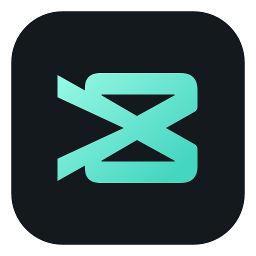

<p align="center">
  
</p>
<h1 align="center">ReaCut · 映刻</h1>
<p align="center"><strong>借助 <a href="https://github.com/morluto/rea">REA</a> 研究剪映 / CapCut，独立重实现的开源视频编辑器。</strong><br />macOS 优先；仅开展授权范围内的研究，不复制剪映专有代码或素材。</p>
<p align="center">完整视频编辑器的实现工作量很大，项目仍处于早期阶段。<br /><strong>欢迎贡献者一起完善功能、交互、跨平台支持、测试和文档。</strong> <a href="#参与贡献">参与贡献 →</a></p>
<p align="center">
  <a href="LICENSE"></a>
  
  
</p>
<p align="center">
  简体中文 · <a href="README.en.md">English</a><br />
  <a href="#快速开始">快速开始</a> · <a href="docs/USER_GUIDE.md">使用指南</a> · <a href="CHANGELOG.md">更新记录</a> · <a href="#参与贡献">参与贡献</a>
</p>


ReaCut 将素材管理、多轨剪辑、字幕和视频导出放在一个熟悉的桌面工作区中。核心编辑流程在本地运行，无需账号或云服务。

项目使用 [REA](https://github.com/morluto/rea) 辅助研究剪映的界面行为和本地项目格式，再以 Electron、React、TypeScript 和 FFmpeg 独立实现编辑器。REA 是开发研究工具，运行 ReaCut 不需要安装 REA、Ghidra 或剪映。

> **开发状态：v0.5.0，早期开发中。** macOS Apple Silicon 已验证；Windows / Linux 已提供构建配置，尚待实机验证。可从 [v0.5.0 预览版 Release](https://github.com/Xiangyu-CAS/rea-capcut/releases/tag/v0.5.0) 下载安装包，或按下方步骤从源码运行。

## 核心功能

| 能力 | 可以做什么 |
| --- | --- |
| **素材与源预览** | 导入视频、音频和图片，查看缩略图与波形；用 I/O 标记入出点，将选段加入时间线。 |
| **多轨剪辑** | 拖拽、裁剪、分割、复制、多选、吸附、锁轨、静音，以及撤销与重做。 |
| **画面与声音** | 变换、裁剪、基础调色、色度抠像、矩形 / 椭圆蒙版、关键帧、音量、淡入淡出和常规变速。 |
| **文字与字幕** | SRT / 基础 WebVTT 导入、逐句编辑、批量替换、时间偏移、统一样式和 SRT 导出。 |
| **本地项目** | `.reacut` 保存、自动恢复、素材重新链接；收集项目素材为可搬移的文件夹。 |
| **视频导出** | 导出整条时间线、选中区间或自定义区间，支持 H.264 / AAC 编码的 MP4 与 MOV。 |
| **文字与效果库** | 16 款可编辑文字模板、16 款调色 / 动效预设、8 款转场，支持动态预览与一次撤销。 |
| **离线素材** | 内置 64 款原创贴纸、背景、标题底板与合成音效，以及 Noto Sans SC 中文字体。 |
| **Codex 插件** | 在 Codex 右侧操作完整编辑器；读取项目、导入素材、批量编辑与撤销。 |
| **可选剪辑助手** | 连接已安装并登录的 Codex CLI / Claude Code，审阅编辑提案后应用，支持一次撤销。 |

完整支持范围与限制见 [功能矩阵](docs/FEATURE_MATRIX.md)。

## 快速开始

### 方式一：独立 DMG 桌面版

下载 [ReaCut 0.5.0 DMG（macOS Apple Silicon）](https://github.com/Xiangyu-CAS/rea-capcut/releases/download/v0.5.0/ReaCut-0.5.0-arm64.dmg)，打开后将应用拖入“应用程序”，直接启动即可剪辑。安装包自带 FFmpeg / FFprobe，不需要另外安装。当前为预览版，采用 ad-hoc 签名，尚未完成 Apple 公证。

### 方式二：作为 Codex 插件在右侧打开

先安装 **ReaCut 0.5.0+** 和 Codex 桌面端，确保终端有 `codex` CLI 与 Python 3。下载 [Codex 插件包](https://github.com/Xiangyu-CAS/rea-capcut/releases/download/v0.5.0/ReaCut-plugin-0.5.0.zip)，在解压目录或仓库目录运行：

```sh
sh scripts/install-plugin.sh
```

重连或新开 Codex 聊天，输入 **“用 ReaCut 在右侧打开视频编辑器”**。可直接在侧栏点击、拖动、输入、保存和导出，也可让 Codex 根据当前项目进行可撤销的批量剪辑。

插件复用本机编辑器；实时画面约 6 fps，文件选择使用系统对话框。应用不在“应用程序”目录时使用 `--app /absolute/path/ReaCut.app`。完整安装、操作方式与限制见 [Codex 插件说明](docs/CODEX_PLUGIN.md)。

### 从源码运行

将仓库克隆或下载到本机后，在项目目录执行。需要：

- **Node.js 26**，或 Node.js **24.11+ 的 24.x 版本**，以及 npm。
- **FFmpeg 与 FFprobe**；FFmpeg 需包含 `libx264` 和 AAC 编码支持。

```sh
npm ci
npm run dev
```

这会启动 Electron 桌面编辑器和本地 Vite 开发服务。媒体工具可放在 `PATH` 中，也可在应用设置中指定路径；配置方式见 [媒体工具说明](docs/MEDIA_TOOLS.md)。

想先试用一个完整工程：

```sh
npm run demo
```

然后在 ReaCut 中打开 `.demo/demo.reacut`。它包含程序生成的原创画面、音乐、字幕与关键帧，详见 [演示工程](docs/DEMO.md)。

### 构建 macOS 安装包

在原生 macOS 主机上安装 Xcode 命令行工具，然后执行：

```sh
npm run dist:mac:installer
```

DMG 和 ZIP 输出到 `release/`。首次构建会下载并编译内置 FFmpeg / FFprobe；安装包用户无需再安装媒体工具。打开 DMG 后，将 ReaCut 拖入“应用程序”。

当前安装包采用本地 ad-hoc 签名，尚未完成 Apple 公证。平台验证与构建细节见 [验证记录](docs/VALIDATION.md) 和 [媒体工具说明](docs/MEDIA_TOOLS.md)。

## 项目与数据

- **本地编辑**：媒体处理、预览、项目保存和导出均在本机完成；普通项目引用本地素材，跨机器使用时可收集项目素材或重新链接。
- **Codex 插件**：媒体处理在本机运行；Codex 可接收工具读取的项目摘要、文字和显式截图。侧栏实时帧仅供界面使用。
- **可选助手**：仅在用户发送消息时，向所选 CLI 服务发送文字和有限时间线摘要，不附带媒体文件。详情见 [助手说明](docs/ASSISTANT.md)。
- **实验性剪映导入**：支持已验证格式中的基础片段转换；复杂文字样式、特效与关键帧可能丢失，不支持写回剪映格式。版本范围见 [互通说明](docs/CAPCUT_INTEROP.md)。

云同步、SaaS、直接 API AI、自动语音字幕与 AI 人像抠像尚未实现。ReaCut 是独立项目，与剪映 / CapCut 无隶属关系。

## 开发

```sh
npm run check          # 类型检查、单元测试与生产构建
npm run test:desktop   # 构建并运行桌面基础工作流测试
npm run check:desktop  # 完整桌面回归
```

更多专项测试、运行条件和已执行的验收结果见 [验证记录](docs/VALIDATION.md)。

```text
src/components/   编辑器界面
src/editor/       状态管理、撤销重做与预览
src/core/         项目模型、时间线、字幕与画面处理
electron/         本地文件桥接、媒体处理与导出
scripts/          素材、图标与安装包构建工具
tests/            核心逻辑、媒体与桌面工作流测试
docs/             用户文档、架构与研究记录
```

## 参与贡献

欢迎提交问题反馈、改进文档或发起 Pull Request。当前尤其欢迎 Windows / Linux 实机验证、大型项目性能优化，以及剪辑交互和无障碍改进。

1. 报告问题时附上系统、ReaCut 版本、复现步骤与预期行为；媒体问题尽量提供可公开的最小样例。
2. 较大的功能调整先通过 Issue 讨论范围，再提交聚焦的改动。
3. 代码改动运行 `npm run check`；涉及桌面交互或导出时，补充对应的工作流验证，并在 PR 中说明结果。

请使用自有或可分发的素材，不提交私人项目、缓存、凭据或 `.research/` 原始数据。

## 文档

| 面向 | 文档 |
| --- | --- |
| 使用与试用 | [使用指南](docs/USER_GUIDE.md) · [演示工程](docs/DEMO.md) · [剪辑助手](docs/ASSISTANT.md) |
| 能力与进展 | [功能矩阵](docs/FEATURE_MATRIX.md) · [更新记录](CHANGELOG.md) · [验证记录](docs/VALIDATION.md) |
| 开发与构建 | [架构](docs/ARCHITECTURE.md) · [媒体工具](docs/MEDIA_TOOLS.md) · [离线素材](docs/ORIGINAL_ASSETS.md) |
| REA 研究与互通 | [REA 研究记录](docs/research/REA_FINDINGS.md) · [界面布局对照](docs/UI_PARITY.md) · [草稿互通](docs/CAPCUT_INTEROP.md) |

## 许可证与致谢

ReaCut 自行编写的源码采用 [MIT License](LICENSE)。第三方组件保留各自许可：内置 FFmpeg / x264 使用 GPL，Noto Sans SC 使用 SIL OFL 1.1；对应声明、许可与媒体工具源码随包提供，见 [第三方声明](THIRD_PARTY_NOTICES.md)。

感谢 [REA](https://github.com/morluto/rea) 及 Electron、React、FFmpeg、Zustand、Lucide、Noto 等开源项目。
