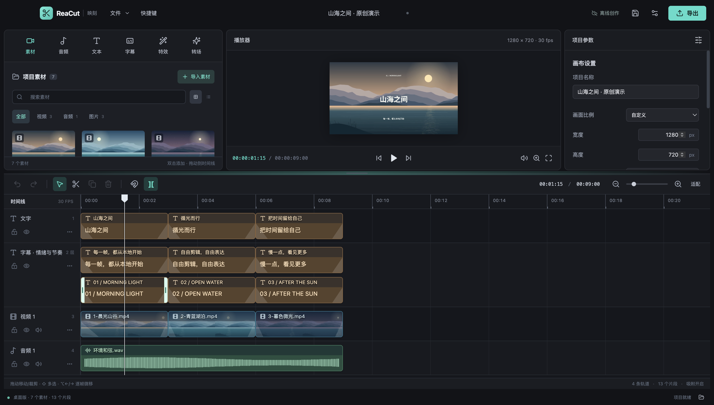

# ReaCut · 映刻

[English](README.en.md)

一个独立实现的离线桌面视频编辑器，macOS 优先，保留 Windows / Linux 构建配置。使用 [REA](https://github.com/morluto/rea) 研究本机剪映可观察的布局与文件结构线索，使用自行编写的代码实现本地剪辑流程。项目没有复制或分发剪映的专有代码、库、商标素材或模板，也不声称完整复现商业剪映。



## 当前能力

- 视频、音频、图片媒体库：导入、搜索、缩略图、波形、丢失素材重新链接；按需要生成本地预览代理，导出使用原素材。
- 多轨时间线：拖拽、裁剪、分割、多选移动、复制粘贴、轨道重命名/排序/删除、锁轨、静音、隐藏、吸附、磁吸删除、缩放和撤销重做。
- 画面和声音：位置、统一缩放、旋转、翻转、透明度、源空间裁剪、RGB 色度抠像、矩形/椭圆蒙版、基础 RGB 调色、模糊、音量、淡入淡出和保持音高的常规变速。
- 文字与字幕：内置 Noto Sans SC 默认字体，可选本机字体、描边、背景、对齐；SRT / 基础 WebVTT 导入和 SRT 导出。
- 关键帧：位置、缩放、旋转、透明度、音量的线性 / 缓入缓出插值；分割和裁剪保留动画曲线与淡化包络。
- 播放器实时拖动画面并保持关键帧路径一起移动，松开合并为一次撤销；到项目末尾保留最终预览帧。时间线高度可拖动或键盘调整。
- `.reacut` 项目保存、打开、最近项目和本地自动恢复；FFmpeg 本地 MP4 / MOV 导出，含进度、取消和临时文件保护。

详细边界见 [功能矩阵](docs/FEATURE_MATRIX.md)。云项目、SaaS、账号和依赖 API 的 AI 能力尚未实现。classic 明文剪映草稿导入是实验性、有损转换；当前本机 11.0 的不透明 `draft_info.json` 不受支持，见 [互通说明](docs/CAPCUT_INTEROP.md)。

本机已通过 104 项自动化测试（9 个测试文件），并完成实际 Electron 导入、编辑、保存重开及本地视频导出。裁剪、反选蒙版、色度抠像另有桌面 UI 和真实导出像素验收。macOS DMG/ZIP 已生成并校验，从最终 DMG 复制的应用已完成字体、预览与九秒混音导出验收，详见 [验证记录](docs/VALIDATION.md)。

## 本地启动

需要 Node.js 26（本机开发使用此版本；也支持 Node.js 24.11 及以上的 24.x）与 npm，以及自行安装的 `ffmpeg`、`ffprobe`。FFmpeg 需含 `libx264` 编码器和 AAC 编码能力。

```sh
npm ci
npm run dev
```

Vite 监听 `127.0.0.1:5173`，同时启动 Electron 桌面窗口。`npm run preview` 是构建后的浏览器预览，完整文件操作与视频导出使用桌面版。

macOS 可自行通过 Homebrew 安装 FFmpeg。也可在应用设置中分别选择 FFmpeg / FFprobe 可执行文件，或启动前设置其绝对路径：

```sh
export REACUT_FFMPEG=/absolute/path/to/ffmpeg
export REACUT_FFPROBE=/absolute/path/to/ffprobe
npm run dev
```

FFmpeg 和 REA 都不随应用打包。REA 是开发取证工具，运行编辑器不需要安装 REA 或剪映。

## 构建与验证

```sh
npm run typecheck
npm test
npm run build
npm run dist:mac
# 生成 macOS DMG 和 ZIP
npm run dist:mac:installer
```

`dist:mac` 在 `release/` 生成本机平台的应用目录；`npm run dist` 使用 electron-builder 的平台配置生成安装包。Windows / Linux 配置已经提供，但本机 macOS 验证不能替代对应系统上的运行验证。macOS 构建采用本地 ad-hoc 签名，并通过严格签名校验；它不是 Apple Developer ID 签名，未公证，也未接入更新服务。

真实媒体与 UI 验证入口：

```sh
npm run fixtures
npm run test:timeline
npm run test:desktop
npm run test:visual
npm run test:storage
npm run test:player
npm run test:audio
npm run test:tracks
npm run licenses
npm run demo
# 已生成 macOS app 后，或 REACUT_TEST_APP 指定 .app 路径
npm run test:package
```

`npm run check:desktop` 可按顺序执行完整编译后桌面回归。UI 脚本使用生成的测试素材及隔离的用户目录；测试过程中仅在其独立 Electron 进程内替换系统文件对话框。浏览器测试需要可用的 Chrome 或 Playwright Chromium，尚未安装时可运行 `npx playwright install chromium`。桌面验收记录见 [VALIDATION.md](docs/VALIDATION.md)，其中明确区分已运行、未覆盖与待打包验证。

## 项目结构

| 路径 | 用途 |
| --- | --- |
| `src/core/` | 项目验证、时间线数学、动画与淡化、字幕、调色、实验性 classic 导入 |
| `src/editor/` | 编辑状态、历史记录、预览图层 |
| `src/components/` | 素材库、时间线、播放器、属性与效果面板 |
| `electron/` | 受限文件桥接、媒体探测 / 代理、FFmpeg 导出 |
| `tests/` | 核心语义、真实导出、浏览器交互与桌面工作流 |
| `docs/research/` | 区分观察、推断与自主设计的 REA 调查结论 |
| `licenses/` | 依赖的原版许可文本、Chromium notices、native SBOM 和来源清单 |

[原创演示工程](docs/DEMO.md) · [操作指南](docs/USER_GUIDE.md) · [架构说明](docs/ARCHITECTURE.md) · [REA 研究记录](docs/research/REA_FINDINGS.md)

## 许可与数据

ReaCut 自行编写的源码使用 [MIT](LICENSE)。第三方组件保留各自许可，见 [第三方声明](THIRD_PARTY_NOTICES.md)。内置的原版 Noto Sans SC 字体使用 SIL OFL 1.1，保留上游版权、许可和来源指纹；其他系统字体可选且不随应用分发。Electron / Chromium 与 canvas 的 Skia 原生依赖也不适用“全部第三方均为 MIT”的概括。

项目文件记录媒体的本机绝对路径，不嵌入源媒体；换机器时需要重新链接。缩略图、代理、最近项目和自动恢复文件保存在 Electron 的本地用户数据目录。应用功能不上传媒体或调用云端服务；开发工具首次安装、依赖下载与构建工具下载仍需要网络。发布仓库时不提交私人项目、媒体、缓存或 `.research/` 原始取证数据。
