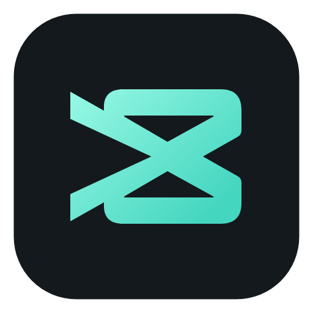
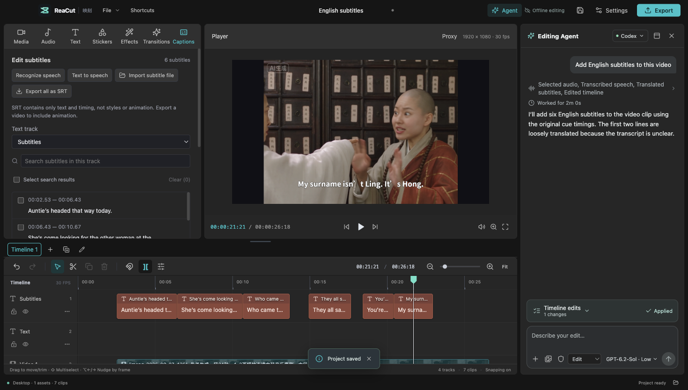

<p align="center">
  
</p>
<h1 align="center">ReaCut</h1>
<p align="center"><strong>An open-source video editor for Windows and Mac.</strong><br />Cut, caption, and export locally. Use the optional Codex Agent to edit the same timeline.</p>
<p align="center">
  <a href="https://github.com/Xiangyu-CAS/ReaCut/releases/download/v0.9.1/ReaCut-0.9.1-x64-Setup.exe"></a>
  <a href="https://github.com/Xiangyu-CAS/ReaCut/releases/download/v0.9.0/ReaCut-0.9.0-arm64.dmg"></a><br />
  <a href="https://reacut.app/">Website</a> · <a href="https://github.com/Xiangyu-CAS/ReaCut/releases">All releases / ZIP / checksums</a> · <a href="#getting-started">Installation guide</a><br />
  <sub>Preview installers · Windows EXE is unsigned · macOS DMG uses ad-hoc signing and lacks notarization.</sub>
</p>
<p align="center">Building a complete video editor is a substantial undertaking, and this project is still in its early stages.<br /><strong>Contributors are welcome to help with features, usability, cross-platform support, tests and documentation.</strong> <a href="#contributing">Get involved →</a></p>
<p align="center">
  <a href="LICENSE"></a>
  
  
  <a href="https://madewithrea.com/builds/reacut-open-source-video-editor-rebuilt-from-rea-assisted-jianying-cap"></a>
  <a href="https://github.com/reacher-z/Awesome-REA"></a>
</p>
<p align="center">
  <strong>English</strong> / <a href="README.zh-CN.md">简体中文</a><br />
  <a href="#getting-started">Getting started</a> · <a href="docs/USER_GUIDE.md">User guide</a> · <a href="docs/WEEKLY_TODO.md">Weekly feature plan (in Chinese)</a> · <a href="CHANGELOG.md">Changelog</a> · <a href="#contributing">Contributing</a>
</p>



ReaCut brings media management, multitrack editing, subtitles and video export into a familiar desktop workspace. Core editing runs locally, without an account or cloud service.

[REA](https://github.com/morluto/rea)-assisted research into CapCut Desktop informed the editing workflows. Earlier research into domestic Jianying covers the versions and samples used for local draft import. ReaCut uses Electron, React, TypeScript and FFmpeg. [CapCut Desktop comparison](docs/research/CAPCUT_DESKTOP_9_8.md) · [Draft import coverage](docs/CAPCUT_INTEROP.md)

> **v0.9.0 Preview** brings the editing Agent to the standalone app. Try “Add English subtitles to this video” to transcribe speech locally, translate it with Codex, and add editable captions to the timeline. See the [release notes](docs/RELEASE_NOTES_0.9.0.md).

## Features

| Area | What you can do |
| --- | --- |
| **Media and source preview** | Import video, audio and images, view thumbnails and waveforms, and mark source in/out points with I/O to add a selected range to the timeline. |
| **Multitrack editing** | Insert, overwrite or overlay source ranges; select, move and trim linked video/audio clips; drag, split, duplicate, select multiple clips, snap, lock tracks, undo and redo. See [workflow and limits (in Chinese)](docs/TIMELINE_EDITING.md). |
| **Reverse and freeze** | Locally reverse a selected video range with reversed or removed audio; insert an adjustable freeze frame at the playhead. [Workflow and limits](docs/REVERSE_FREEZE.md). |
| **Keyframe curves** | Drag and precisely edit points, copy/paste curves, and choose linear, ease-in, ease-out or smooth easing for motion, opacity and volume. [Workflow and validation](docs/KEYFRAME_CURVES.md); included in the v0.7.0 preview. |
| **Picture and sound** | Transform, crop, apply basic color adjustments, chroma key, rectangle / ellipse masks, keyframes, volume, fades and constant speed changes. |
| **Text and subtitles** | Import SRT / basic WebVTT, edit cues, batch-replace text, shift timing and export SRT. New in this preview: caret/playhead split, consecutive merge, editable batch styles and entrance/hold/exit animation. [Workflow and validation](docs/SUBTITLE_WORKFLOW.md); included in the v0.7.0 preview. |
| **Local speech** | Offline transcription on Apple Silicon with separately installed MLX Whisper/model; macOS system TTS. [Setup, downloads and platform limits](docs/LOCAL_SPEECH.md). |
| **Local projects** | Save `.reacut` projects, automatically recover edits, relink media and collect project media into a portable folder. |
| **Project templates** | Save reusable templates with covers and named media/text slots; batch replace into an independent project, import/export media bundles, and start from three original examples. [Workflow and validation](docs/PROJECT_TEMPLATES.md); included in the v0.7.0 preview. |
| **Video export** | Render the full timeline, a selection or a custom range to MP4 / MOV with H.264 and AAC. |
| **Text & effect libraries** | 16 editable text templates, 16 color / motion presets, and 8 transitions with animated previews and one-step undo. |
| **Offline assets** | Use 64 original stickers, backgrounds, title plates and synthesized sounds, plus the bundled Noto Sans SC font. |
| **Codex plugin** | Edit the open timeline from the Codex side panel or chat. [Plugin workflow](docs/CODEX_PLUGIN.md) |
| **Editing Agent** | Opens on the right. Sign in with ChatGPT through Codex App Server, edit selected media ranges, or ask for subtitles from local speech recognition. Apply edits with one-step undo or request a preview first. [Editing Agent](docs/ASSISTANT.md) |
| **Online music** | Search from the Editing Agent without signing in, preview supported tracks, and download into a separate audio track. [Workflow and credits](docs/ONLINE_MUSIC.md) |

See the [feature matrix](docs/FEATURE_MATRIX.md) for detailed support and limitations.

Use [loudness normalization and background-music ducking](docs/AUDIO_MIX.md), template-based [batch export from Codex](docs/CODEX_PLUGIN.md#从同一模板生成多支视频), guided local caption setup, and a lower-resolution preview proxy switch.

ReaCut supports multiple timelines per project, group import of supported Jianying drafts, local beat editing, speed curves and optional macOS VideoToolbox H.264 export. [Editing guide](docs/USER_GUIDE.md) · [Draft import coverage](docs/CAPCUT_INTEROP.md)

## Getting started

**Interface language.** Open **Settings → Language** or press **Cmd/Ctrl+,**. New installations **Follow System**, with English as the fallback. Choose a language to save a manual preference, or select **Follow System** to resume automatic selection. [Language coverage and tests](docs/LOCALIZATION.md).

**Manual updates:** Settings or native Help → **Check for Updates** checks the Preview channel on request. Open the matching desktop installer in your browser. GitHub receives the ordinary connecting IP address. [Behavior and limits](docs/MANUAL_UPDATES.md).

### Option 1: standalone desktop app

On **Windows 10/11 x64**, download and run the [ReaCut 0.9.1 EXE installer](https://github.com/Xiangyu-CAS/ReaCut/releases/download/v0.9.1/ReaCut-0.9.1-x64-Setup.exe). FFmpeg and FFprobe are included. The preview installer is unsigned, so Windows may show a SmartScreen warning. MLX transcription, macOS system voices, and the Codex plugin are outside the Windows preview.

Download the [ReaCut 0.9.0 DMG for macOS Apple Silicon](https://github.com/Xiangyu-CAS/ReaCut/releases/download/v0.9.0/ReaCut-0.9.0-arm64.dmg), open it, drag the app into Applications, and launch it. FFmpeg and FFprobe are bundled. This preview uses ad-hoc signing and lacks Apple notarization.

### Option 2: inside the Codex side panel

On macOS, use a matching ReaCut **0.9.1+** app and plugin ZIP, Codex desktop, its `codex` CLI, and Python 3. Run the installer from the extracted plugin package or this repository. The [plugin guide](docs/CODEX_PLUGIN.md) has the build commands.

```sh
sh scripts/install-plugin.sh
```

Reconnect or open a new Codex chat and ask: **“Open ReaCut in the side panel.”** Click, drag, type, save and export directly in the side panel, or ask Codex to make reversible batch edits to the current project. If the app is outside Applications, pass `--app /absolute/path/ReaCut.app`.

The sidebar renders ReaCut's timeline, player, media library and inspector directly. Text fields support the host input method and clipboard. File selection uses system dialogs, and the sidebar and MCP tools share a project. The desktop plugin uses local stdio. A tools-only profile is available for private ChatGPT MCP connections through [Secure MCP Tunnel](https://developers.openai.com/api/docs/guides/secure-mcp-tunnels).

### Run from source

Clone or download this repository, then run the following commands in its directory. Requirements:

- **Node.js 26**, or **Node.js 24.x starting at 24.11**, and npm.
- **FFmpeg and FFprobe**, with `libx264` and AAC encoding enabled in FFmpeg.

```sh
npm ci
npm run dev
```

This launches the Electron editor and the local Vite development server. Put the media tools on `PATH` or select their paths in application settings; see [media tools](docs/MEDIA_TOOLS.md).

To try a complete example project:

```sh
npm run demo
```

Open `.demo/demo.reacut` in ReaCut. It includes programmatically generated original footage, music, subtitles and keyframes. See the [demo guide](docs/DEMO.md).

### Build a macOS installer

Install Xcode command line tools on a native macOS host, then run:

```sh
npm run dist:mac:installer
```

DMG and ZIP files are written to `release/`. The first build downloads and compiles bundled FFmpeg / FFprobe; installer users do not need to install media tools separately. Open the DMG and drag ReaCut into Applications.

Current builds use local ad-hoc signing and are not Apple-notarized. See [validation](docs/VALIDATION.md) and [media tools](docs/MEDIA_TOOLS.md) for platform coverage and build details.

### Build a Windows installer

Prepare the Windows x64 media bundle with the [MinGW-w64 build recipe](docs/MEDIA_TOOLS.md#windows-x64). On Windows x64, run `npm ci`, `node node_modules/electron/install.js`, `npm run licenses`, and `npm run dist:win`. The NSIS installer is written to `release/`.

## Projects and data

- **Local editing:** media processing, preview, project storage and export run on your machine. Ordinary projects reference local media; collect project media or relink files when moving between machines.
- **Codex plugin:** media processing runs locally. Codex can receive project summaries, text and explicitly requested screenshots read through its tools. The live side-panel frames are only used by the interface. See the [plugin guide](docs/CODEX_PLUGIN.md).
- **Optional agent:** sending shares your message, recent chat and a limited summary of the active timeline with the selected service. The Codex App Server also receives any selected reference frames and timed text from caption requests. [Editing agent](docs/ASSISTANT.md)
- **Experimental Jianying import:** converts basic clips from verified formats. Complex text styles, effects and keyframes may be lost; writing back to Jianying format is unsupported. See [interoperability](docs/CAPCUT_INTEROP.md) for version coverage.

Cloud sync, SaaS, direct AI API integration and AI portrait cutout are not implemented. ReaCut is an independent project and is not affiliated with Jianying / CapCut.

## Development

```sh
npm run check          # Type checks, unit tests and production build
npm run test:desktop   # Build and test the basic desktop workflow
npm run check:desktop  # Full desktop regression suite
```

See [validation](docs/VALIDATION.md) for specialized tests, prerequisites and recorded results.

```text
src/components/   Editor interface
src/editor/       State, undo/redo and preview
src/core/         Project model, timeline, subtitles and visual processing
electron/         Local file bridge, media processing and export
scripts/          Asset, icon and package build tools
tests/            Core logic, media and desktop workflow tests
docs/             User guides, architecture and research notes
```

## Contributing

Bug reports, documentation improvements and pull requests are welcome. Useful areas include Windows / Linux testing, large-project performance, editing interactions and accessibility.

1. Include your OS, ReaCut version, reproduction steps and expected behavior in bug reports. For media issues, use a minimal sample that can be shared publicly.
2. Discuss substantial feature changes in an issue before starting a large implementation.
3. Run `npm run check` for code changes. For desktop interactions or export changes, run the relevant workflow checks and describe the results in your PR.

Use media you own or can redistribute. Keep private projects, caches, credentials and raw `.research/` data out of contributions.

## Documentation

Most detailed guides are currently in Chinese.

| Audience | Guides |
| --- | --- |
| Users | [User guide](docs/USER_GUIDE.md) · [Demo project](docs/DEMO.md) · [Editing assistant](docs/ASSISTANT.md) |
| Capabilities and progress | [Feature matrix](docs/FEATURE_MATRIX.md) · [Changelog](CHANGELOG.md) · [Validation](docs/VALIDATION.md) |
| Developers | [Architecture](docs/ARCHITECTURE.md) · [Media tools](docs/MEDIA_TOOLS.md) · [Offline assets](docs/ORIGINAL_ASSETS.md) |
| REA research and interoperability | [REA findings](docs/research/REA_FINDINGS.md) · [Interface comparison](docs/UI_PARITY.md) · [Draft interoperability](docs/CAPCUT_INTEROP.md) |

## License and acknowledgments

ReaCut's own source code is licensed under the [MIT License](LICENSE). Third-party components retain their respective licenses: bundled FFmpeg / x264 use GPL, and Noto Sans SC uses SIL OFL 1.1. Notices, licenses and corresponding media-tool sources accompany the package; see [third-party notices](THIRD_PARTY_NOTICES.md).

Thanks to [REA](https://github.com/morluto/rea) and the Electron, React, FFmpeg, Zustand, Lucide and Noto communities.
