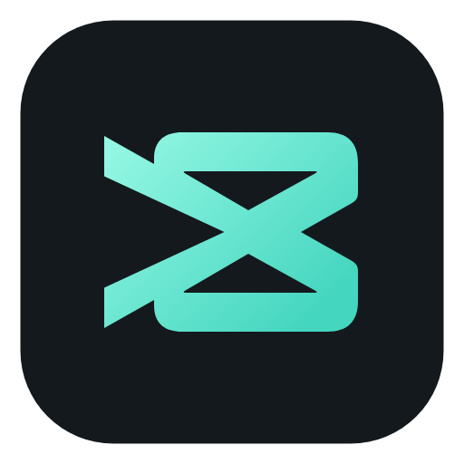
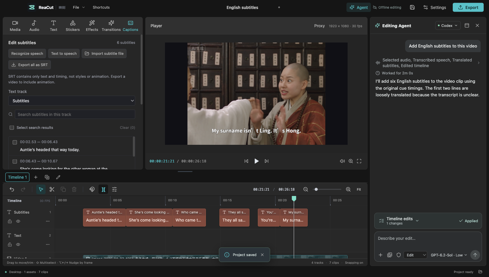

<p align="center">
  
</p>
<h1 align="center">ReaCut · 映刻</h1>
<p align="center"><strong>适用于 Windows 和 Mac 的开源视频编辑器。</strong><br />在本机剪辑、加字幕和导出，也可用 Codex Agent 编辑同一条时间线。</p>
<p align="center">
  <a href="https://github.com/Xiangyu-CAS/ReaCut/releases/download/v0.9.1/ReaCut-0.9.1-x64-Setup.exe"></a>
  <a href="https://github.com/Xiangyu-CAS/ReaCut/releases/download/v0.9.0/ReaCut-0.9.0-arm64.dmg"></a><br />
  <a href="https://reacut.app/zh-cn/">产品网站</a> · <a href="https://github.com/Xiangyu-CAS/ReaCut/releases">全部 Releases / ZIP / 校验和</a> · <a href="#快速开始">安装说明</a><br />
  <sub>预览版安装包 · Windows EXE 未签名 · macOS DMG 采用 ad-hoc 签名，尚未公证。</sub>
</p>
<p align="center">完整视频编辑器的实现工作量很大，项目仍处于早期阶段。<br /><strong>欢迎贡献者一起完善功能、交互、跨平台支持、测试和文档。</strong> <a href="#参与贡献">参与贡献 →</a></p>
<p align="center">
  <a href="LICENSE"></a>
  
  
  <a href="https://github.com/reacher-z/Awesome-REA"></a>
</p>
<p align="center">
  <a href="README.md">English</a> / <strong>简体中文</strong><br />
  <a href="#快速开始">快速开始</a> · <a href="docs/USER_GUIDE.md">使用指南</a> · <a href="docs/WEEKLY_TODO.md">本周功能计划</a> · <a href="CHANGELOG.md">更新记录</a> · <a href="#参与贡献">参与贡献</a>
</p>



ReaCut 将素材管理、多轨剪辑、字幕和视频导出放在一个熟悉的桌面工作区中。核心编辑流程在本地运行，无需账号或云服务。

剪辑工作流参考了用 [REA](https://github.com/morluto/rea) 对国际版 CapCut Desktop 所做的授权研究。国内剪映的历史研究提供本地草稿导入的版本与样本依据。ReaCut 使用 Electron、React、TypeScript 和 FFmpeg。 [国际版对照](docs/research/CAPCUT_DESKTOP_9_8.md) · [草稿覆盖范围](docs/CAPCUT_INTEROP.md)

> 独立桌面版 **v0.9.0** 加入了剪辑 Agent。试试「给这个视频加英文字幕」，ReaCut 本机识别语音，Codex 翻译文字，字幕可直接在时间线上编辑。 [发布说明](docs/RELEASE_NOTES_0.9.0.md)

## 核心功能

支持响度统一、背景音乐压低、Codex 模板批量出片、本地字幕设置和低分辨率预览代理。 [声音处理](docs/AUDIO_MIX.md) · [插件流程](docs/CODEX_PLUGIN.md#从同一模板生成多支视频) · [本地字幕](docs/LOCAL_SPEECH.md)

支持工程多时间线、剪映草稿整组导入、本地节拍剪辑、曲线变速和 macOS VideoToolbox H.264 导出。 [操作指南](docs/USER_GUIDE.md) · [草稿导入范围](docs/CAPCUT_INTEROP.md)

| 能力 | 可以做什么 |
| --- | --- |
| **素材与源预览** | 导入视频、音频和图片，查看缩略图与波形；用 I/O 标记入出点，将选段加入时间线。 |
| **多轨剪辑** | 插入 / 覆盖 / 叠加入轨，画声关联移动和裁剪；拖拽、分割、复制、多选、吸附、锁轨及撤销重做。见 [操作说明](docs/TIMELINE_EDITING.md)。 |
| **倒放与定格** | 本地倒放所选视频选段，可倒放或移除原声；播放头插入可调时长静帧，见 [操作与边界](docs/REVERSE_FREEZE.md)。 |
| **关键帧曲线** | 拖动控制点、精确输入、复制粘贴，提供线性/缓入/缓出/缓入缓出，用于运镜、透明度和音量。见 [操作与验收](docs/KEYFRAME_CURVES.md)，纳入 v0.7.0 预览。 |
| **画面与声音** | 变换、裁剪、基础调色、色度抠像、矩形 / 椭圆蒙版、关键帧、音量、淡入淡出和常规变速。 |
| **本地语音** | Apple Silicon 离线 Whisper 自动字幕、macOS 中文/英文配音；需要已有本地模型/系统声音，见 [操作与依赖](docs/LOCAL_SPEECH.md)。 |
| **文字与字幕** | SRT / 基础 WebVTT 导入、逐句编辑、批量替换、时间偏移和 SRT 导出。新增播放头/文本光标拆分、连续合并、可编辑批量样式及入场/停留/出场动画，见 [操作与验收](docs/SUBTITLE_WORKFLOW.md)，纳入 v0.7.0 预览。 |
| **本地项目** | `.reacut` 保存、自动恢复、素材重新链接；收集项目素材为可搬移的文件夹。 |
| **工程模板** | 保存封面与素材/文案占位，批量替换后新建独立工程，导入/导出模板媒体包，附三套原创示例。见 [操作与验收](docs/PROJECT_TEMPLATES.md)，纳入 v0.7.0 预览。 |
| **视频导出** | 导出整条时间线、选中区间或自定义区间，支持 H.264 / AAC 编码的 MP4 与 MOV。 |
| **文字与效果库** | 16 款可编辑文字模板、16 款调色 / 动效预设、8 款转场，支持动态预览与一次撤销。 |
| **离线素材** | 内置 64 款原创贴纸、背景、标题底板与合成音效，以及 Noto Sans SC 中文字体。 |
| **Codex 插件** | 在 Codex 侧栏操作完整编辑器，也可从对话直接编辑当前时间线。 [插件工作流](docs/CODEX_PLUGIN.md) |
| **剪辑 Agent** | 默认打开右侧面板。用本机 Codex App Server 登录后，可直接编辑素材选段、用本地语音识别生成字幕，也可要求先预览。编辑支持一次撤销。 [操作说明](docs/ASSISTANT.md) |

完整支持范围与限制见 [功能矩阵](docs/FEATURE_MATRIX.md)。

## 快速开始

**界面语言。** 打开右上角 **设置 → 语言**，或按 **Cmd/Ctrl+,**。新安装默认「跟随系统」，匹配不到时使用英文。手动选择保存在本机，随时可切回「跟随系统」。 [语言支持与验证](docs/LOCALIZATION.md)

### 方式一：独立桌面版

**Windows 10/11 x64** 用户可下载并运行 [ReaCut 0.9.1 EXE 安装包](https://github.com/Xiangyu-CAS/ReaCut/releases/download/v0.9.1/ReaCut-0.9.1-x64-Setup.exe)。包内自带 FFmpeg 和 FFprobe。预览版安装包未签名，Windows 可能显示 SmartScreen 提示。MLX 本地识别、macOS 系统配音和 Codex 插件暂未纳入 Windows 预览版。

下载 [ReaCut 0.9.0 DMG（macOS Apple Silicon）](https://github.com/Xiangyu-CAS/ReaCut/releases/download/v0.9.0/ReaCut-0.9.0-arm64.dmg)，打开后将应用拖入“应用程序”，直接启动即可剪辑。安装包自带 FFmpeg / FFprobe，不需要另外安装。当前为预览版，采用 ad-hoc 签名，尚未完成 Apple 公证。

### 方式二：作为 Codex 插件在右侧打开

先安装 **ReaCut 0.9.0** 和 Codex 桌面端，确保终端有 `codex` CLI 与 Python 3。下载 [Codex 插件包](https://github.com/Xiangyu-CAS/ReaCut/releases/download/v0.9.0/ReaCut-plugin-0.9.0.zip)，在解压目录或仓库目录运行：

```sh
sh scripts/install-plugin.sh
```

重连或新开 Codex 聊天，输入 **“用 ReaCut 在右侧打开视频编辑器”**。可直接在侧栏点击、拖动、输入、保存和导出，也可让 Codex 根据当前项目进行可撤销的批量剪辑。

插件复用本机编辑器；实时画面约 6 fps，文件选择使用系统对话框。应用不在“应用程序”目录时使用 `--app /absolute/path/ReaCut.app`。完整安装、操作方式与限制见 [Codex 插件说明](docs/CODEX_PLUGIN.md)。

### 从源码运行

将仓库克隆或下载到本机后，在项目目录执行。需要：

- **Node.js 26**，或 Node.js **24.11+ 的 24.x 版本**，以及 npm。
- **FFmpeg 与 FFprobe**；FFmpeg 需包含 `libx264` 和 AAC 编码支持。

```sh
npm ci
npm run dev
```

这会启动 Electron 桌面编辑器和本地 Vite 开发服务。媒体工具可放在 `PATH` 中，也可在应用设置中指定路径；配置方式见 [媒体工具说明](docs/MEDIA_TOOLS.md)。

想先试用一个完整工程：

```sh
npm run demo
```

然后在 ReaCut 中打开 `.demo/demo.reacut`。它包含程序生成的原创画面、音乐、字幕与关键帧，详见 [演示工程](docs/DEMO.md)。

### 构建 macOS 安装包

在原生 macOS 主机上安装 Xcode 命令行工具，然后执行：

```sh
npm run dist:mac:installer
```

DMG 和 ZIP 输出到 `release/`。首次构建会下载并编译内置 FFmpeg / FFprobe；安装包用户无需再安装媒体工具。打开 DMG 后，将 ReaCut 拖入“应用程序”。

当前安装包采用本地 ad-hoc 签名，尚未完成 Apple 公证。平台验证与构建细节见 [验证记录](docs/VALIDATION.md) 和 [媒体工具说明](docs/MEDIA_TOOLS.md)。

### 构建 Windows 安装包

先按 [MinGW-w64 构建说明](docs/MEDIA_TOOLS.md#windows-x64) 准备 Windows x64 媒体工具，再在 Windows x64 上依次运行 `npm ci`、`node node_modules/electron/install.js`、`npm run licenses` 和 `npm run dist:win`。NSIS 安装包输出到 `release/`。

## 项目与数据

- **本地编辑**：媒体处理、预览、项目保存和导出均在本机完成；普通项目引用本地素材，跨机器使用时可收集项目素材或重新链接。
- **Codex 插件**：媒体处理在本机运行；Codex 可接收工具读取的项目摘要、文字和显式截图。侧栏实时帧仅供界面使用。
- **可选 Agent**：点击发送后，所选服务收到问题、近期对话和有限的当前时间线摘要。使用 Codex App Server 时，还会收到选中的参考帧，以及字幕请求产生的带时间戳文字。 [操作说明](docs/ASSISTANT.md)
- **实验性剪映导入**：支持已验证格式中的基础片段转换；复杂文字样式、特效与关键帧可能丢失，不支持写回剪映格式。版本范围见 [互通说明](docs/CAPCUT_INTEROP.md)。

云同步、SaaS、直接 API AI 与 AI 人像抠像尚未实现。ReaCut 是独立项目，与剪映 / CapCut 无隶属关系。

## 开发

```sh
npm run check          # 类型检查、单元测试与生产构建
npm run test:desktop   # 构建并运行桌面基础工作流测试
npm run check:desktop  # 完整桌面回归
```

更多专项测试、运行条件和已执行的验收结果见 [验证记录](docs/VALIDATION.md)。

```text
src/components/   编辑器界面
src/editor/       状态管理、撤销重做与预览
src/core/         项目模型、时间线、字幕与画面处理
electron/         本地文件桥接、媒体处理与导出
scripts/          素材、图标与安装包构建工具
tests/            核心逻辑、媒体与桌面工作流测试
docs/             用户文档、架构与研究记录
```

## 参与贡献

欢迎提交问题反馈、改进文档或发起 Pull Request。当前尤其欢迎 Windows / Linux 实机验证、大型项目性能优化，以及剪辑交互和无障碍改进。

1. 报告问题时附上系统、ReaCut 版本、复现步骤与预期行为；媒体问题尽量提供可公开的最小样例。
2. 较大的功能调整先通过 Issue 讨论范围，再提交聚焦的改动。
3. 代码改动运行 `npm run check`；涉及桌面交互或导出时，补充对应的工作流验证，并在 PR 中说明结果。

请使用自有或可分发的素材，不提交私人项目、缓存、凭据或 `.research/` 原始数据。

## 文档

| 面向 | 文档 |
| --- | --- |
| 使用与试用 | [使用指南](docs/USER_GUIDE.md) · [演示工程](docs/DEMO.md) · [剪辑助手](docs/ASSISTANT.md) |
| 能力与进展 | [功能矩阵](docs/FEATURE_MATRIX.md) · [更新记录](CHANGELOG.md) · [验证记录](docs/VALIDATION.md) |
| 开发与构建 | [架构](docs/ARCHITECTURE.md) · [媒体工具](docs/MEDIA_TOOLS.md) · [离线素材](docs/ORIGINAL_ASSETS.md) |
| REA 研究与互通 | [REA 研究记录](docs/research/REA_FINDINGS.md) · [界面布局对照](docs/UI_PARITY.md) · [草稿互通](docs/CAPCUT_INTEROP.md) |

## 许可证与致谢

ReaCut 自行编写的源码采用 [MIT License](LICENSE)。第三方组件保留各自许可：内置 FFmpeg / x264 使用 GPL，Noto Sans SC 使用 SIL OFL 1.1；对应声明、许可与媒体工具源码随包提供，见 [第三方声明](THIRD_PARTY_NOTICES.md)。

感谢 [REA](https://github.com/morluto/rea) 及 Electron、React、FFmpeg、Zustand、Lucide、Noto 等开源项目。

## 手动检查更新（v0.7.1）

设置或原生帮助菜单中的「检查更新」可按需检查预览通道，显示更新说明，并在浏览器打开匹配的安装包。GitHub 会接收普通连接的 IP 地址。详见 [手动更新的行为与限制](docs/MANUAL_UPDATES.md)。
