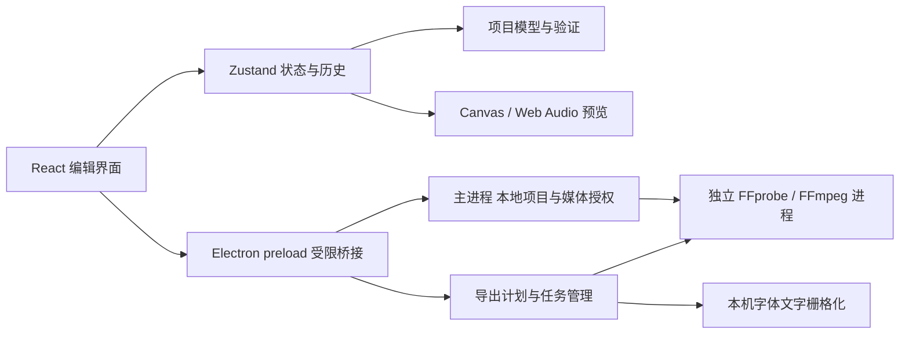

# 架构

ReaCut 的编辑模型、预览与导出由独立代码实现。REA 只用于开发阶段记录指定剪映安装包和授权测试项目的观察证据，不参与应用运行。

## 项目与编辑内核

`Project.version` 为 1。项目包含画布、帧率、背景、素材、轨道和片段；素材记录本机路径和媒体元数据，片段引用素材与轨道 ID。项目以 JSON 写入 `.reacut` 文件，不嵌入媒体。秒是统一时间单位，交互边缘通常按项目帧率取整。

`sourceIn` 是源素材入点；时间线局部时间 `t` 对应 `sourceIn + t * speed`。`duration` 是时间线时长，变速保持源范围并调整时长。视频、图片和文字按轨道次序合成；同轨重叠片段按时间次序绘制。同轨叠化通过片段重叠和后片段透明度淡入实现，暂未建立独立转场对象。

每个关键帧的 `easing` 描述结束于该帧的区间。线性与 smoothstep 缓入缓出由预览、模型和导出共同使用。`easingWindow` 记录曲线的截取区间；分割和裁剪加入边界锚点，保持原曲线。`videoFadeWindow` 与 `audioFadeWindow` 保留原包络时长、偏移及淡入淡出范围；变速等比例缩放其秒数。手动设置淡化参数时重置对应截取窗口。

store 使用独立快照维护撤销/重做，持续属性编辑可通过 transaction 合并为一步。轨道锁限制编辑动作；磁吸删除按同轨被删区间的并集压缩后续起点，不重复扣除重叠片段时长。锁定不影响播放或导出。轨道删除连同片段原子提交，保留媒体库并清理选择；排序不移动锁轨或交换锁定邻轨。

`validateProject(unknown)` 验证持久化输入的结构、所有必填字段、有限数值、引用、ID、类型和支持范围；返回隔离副本。外部项目不会直接以类型断言视为可信。

## 媒体与预览

主进程使用 FFprobe 探测本地文件，通过 FFmpeg 生成缩略图、波形，以及 Chromium 无法直接解码时的本地兼容代理。素材库记录原始媒体路径；代理仅用于预览，导出仍读原文件。缓存按来源路径、文件信息与兼容参数区分，位于本地用户数据目录。

播放器使用 HTML 媒体元素解码、Canvas 合成和 Web Audio gain 混音。文本默认使用随应用分发的原版 Noto Sans SC（SIL OFL 1.1）；本机字体作为可选项。基础 RGB 调整的数学操作由共享 helper 定义，导出用对应 FFmpeg 滤镜；显示缩放、视频解码、字体引擎及模糊实现仍可能造成像素差异。实时拖动先在预览状态中反馈画面与动画路径偏移，松开再提交一次编辑；项目末尾保留最终帧。预览不是颜色管理或 HDR 监看工具。

source-space 裁剪、RGB 色度抠像和矩形/椭圆蒙版采用可选项目字段与共享 source-space helper，包含整像素裁剪和 alpha 量化约定。真实桌面 UI、项目持久化及 FFmpeg 输出像素已验证，覆盖与容差见验证记录。它们不是从剪映专有算法复制的实现。

## 文件桥接与导出

renderer 没有 Node.js 权限。preload 只暴露编辑所需方法；主进程校验调用来自主窗口及主 frame。`reacut-media` scheme 提供已授权本地媒体，支持 range 请求。生产 HTML 使用 CSP；外部窗口和应用页面导航被限制。

项目和最近列表通过同目录临时文件与 rename 保存。自动保存写入串行队列。导出将源裁剪、变速、画面处理、文字图层、关键帧、淡化和混音编译为 FFmpeg filter graph，使用独立进程，不启用 shell 拼接执行。

导出先写唯一临时路径，成功后替换用户选择的目标；失败或取消不把不完整视频覆盖到目标。任务报告进度，关闭应用时终止媒体和导出子进程并清理临时数据。MP4 / MOV 当前均使用 H.264 与 AAC，不是原始码流智能复制。

## 边界

云项目、登录、SaaS 与 API AI 没有服务端或隐藏实现。classic 剪映导入器只转换明文基础时间线，输入和测试均不能证明本机 11.0 不透明草稿互通。Windows/Linux 的代码与构建目标需要在对应系统上独立运行验证。完整性能上限、长期大型项目编辑、HDR/专业颜色管理和所有第三方媒体编解码组合尚未验证。
