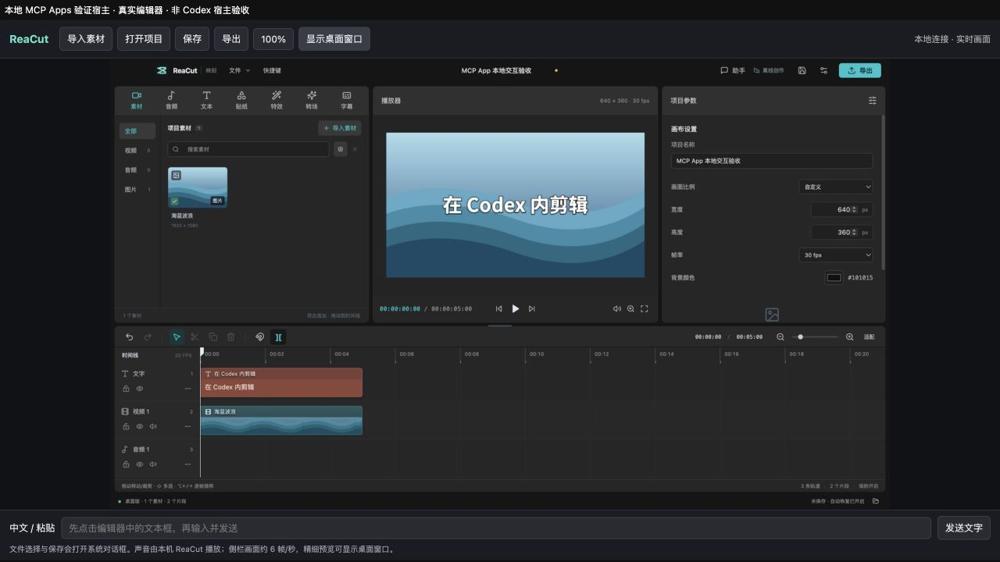

# 在 Codex 中使用 ReaCut

ReaCut 提供两种入口：独立 DMG 桌面应用，以及 Codex 桌面端右侧的插件面板。两者使用同一套编辑器和本地媒体引擎。插件需要本机安装 **ReaCut 0.5.0 或更新版本**，不是云端剪辑服务。

## 安装

1. 从 [v0.5.0 Release](https://github.com/Xiangyu-CAS/rea-capcut/releases/tag/v0.5.0) 下载 DMG 与插件 ZIP。打开 ReaCut DMG，将应用拖入“应用程序”，至少启动一次确认系统允许运行。
2. 安装 Codex 桌面端及其 CLI，确保终端可以运行 `codex`，并有 Python 3。
3. 在 ReaCut 源码目录，或解压后的 `ReaCut-plugin-0.5.0.zip` 目录执行：

```sh
sh scripts/install-plugin.sh
```

应用放在其他位置时：

```sh
sh scripts/install-plugin.sh --app /absolute/path/ReaCut.app
```

脚本先核对应用版本，再通过 `codex plugin marketplace add` 和 `codex plugin add` 安装本地插件。不修改 Codex 的工具审批策略。指定路径记录在 `~/.config/reacut/plugin.json`；环境变量 `REACUT_APP` 可覆盖它。默认寻找 `/Applications/ReaCut.app` 和 `~/Applications/ReaCut.app`。

重连或新开 Codex 聊天，让工具和 skill 加载，然后输入：

> 用 ReaCut 在右侧打开视频编辑器。

也可以先在插件列表启用 ReaCut，再使用 `$reacut`。

## 直接操作与让 Codex 剪辑

右侧是本地 ReaCut 的实时交互画面，支持点击、拖动片段、滚轮、键盘快捷键。窄面板默认适应窗口；点击 **100%** 可按原始尺寸滚动查看。中文或长文本可先点击编辑器的输入框，再用底部输入栏发送。

上方工具栏可导入、打开、保存和导出。文件选择/保存会弹出 macOS 系统对话框；若被其他窗口遮挡，点击“显示桌面窗口”。完整素材、文字、特效、转场和导出工作流沿用桌面版。

macOS 插件在后台连接时不显示 Dock 图标；点击“显示桌面窗口”后才显示。关闭这个窗口会隐藏图标并保留插件会话。直接启动桌面版仍正常显示在 Dock 中。

也可以告诉 Codex：

> 用内置海洋背景做一个 5 秒标题视频，添加“我的第一支视频”，然后让我检查。

Codex 可读取当前项目、导入指定素材、添加文字与片段、裁剪、分割、移动、调整画面/声音、播放、定位、撤销和重做。批量编辑需带当前 revision；你在界面中修改后，旧提案会被拒绝，防止覆盖新编辑。每次批量编辑都可一次撤销。

## 当前限制

- 采用与 [iPhone-use](https://github.com/zhongerxin/iPhone-use) 类似的 MCP App 实时画面桥接。侧栏约 6 fps，实际速度受宿主和窗口大小影响；这是交互画面，不是原帧率视频监看。声音由本机 ReaCut 播放。精细预览可显示桌面窗口。
- 侧栏不支持直接从 Finder 拖入文件；使用“导入素材”或明确指定路径。中文输入推荐底部输入栏。
- 插件会话独立运行，每次连接的恢复数据隔离保存在 `~/Library/Application Support/ReaCut-Plugin/sessions/<会话>/`，`reacut_state` 返回 recoveryPath；重连后可打开该 `autosave.reacut` 恢复。重要项目应主动保存。不会自动接管桌面版未保存的项目；通过保存、打开 `.reacut` 文件交换。
- 本地 stdio 插件面向 Codex 桌面端；Codex CLI 可使用工具，但没有图形侧栏。不是 ChatGPT 网页插件，也尚未提交公共插件目录。
- 首版在 macOS Apple Silicon 验证。Windows / Linux 需要平台应用路径及独立验收。

## 数据与权限

插件不启动 HTTP 服务，不增加遥测、登录、云同步或直接 AI API。媒体预览、保存和导出在本机运行；插件只启动自己的 ReaCut 会话，不捕获其他应用。

Codex 会接收到它主动读取的项目摘要、文字、操作结果，以及显式请求的截图。实时帧工具仅供侧栏调用。数据仍受 Codex 自身的数据处理方式约束，不能理解为所有信息绝不离开本机。导入工具只应使用用户明确授权的文件。

## 构建与验证

以下构建命令在源码仓库执行；插件 ZIP 仅包含安装所需文件。

```sh
npm ci
npm run build
npm run test:plugin
npm run dist:mac:installer
npm run plugin:pack
```

DMG / 应用由 Electron Builder 生成；插件 ZIP 输出到 `release/ReaCut-plugin-0.5.0.zip`。ZIP 包含 portable `plugin.json` / `mcp.json`、Codex 兼容 manifest、skill、Python 启动器与安装脚本。编辑器和自包含 MCP App UI 随 DMG 分发，因此插件包不再复制视频引擎。

开发协议验收使用隔离数据目录。安装包验收可通过 `REACUT_TEST_APP=/absolute/path/ReaCut.app/Contents/MacOS/ReaCut npm run test:plugin` 指定实际程序。

协议依据：[OpenAI 插件打包](https://developers.openai.com/plugins/build/plugins)、[MCP Apps](https://modelcontextprotocol.io/docs/extensions/apps)。参考 iPhone-use 的 manifest、fullscreen resource 与实时帧桥接结构；ReaCut 的编辑、输入和打包实现为本项目代码。

## 本地交互验收截图

下图来自独立的本地 MCP Apps 验证宿主，展示实际 ReaCut 编辑器和插件 UI；不是已通过的 Codex 宿主截图。


