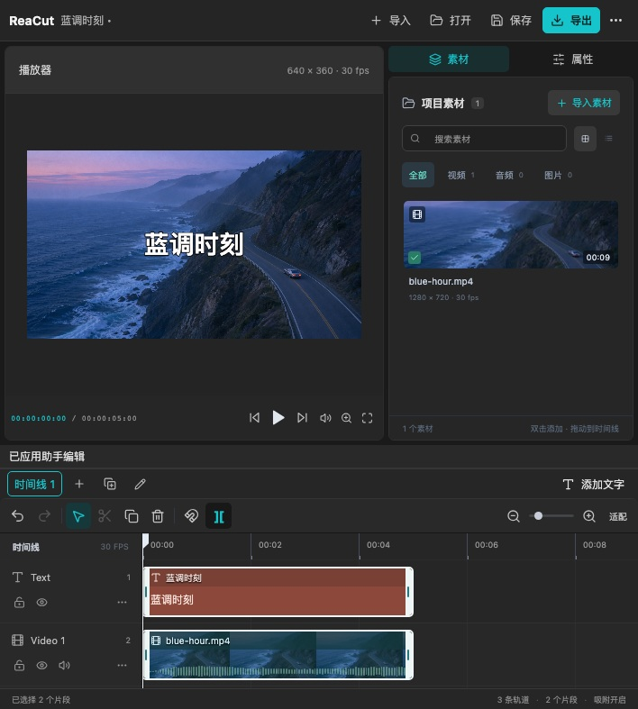

# 在 Codex 和 ChatGPT 中使用 ReaCut

ReaCut 的桌面插件直接在侧栏显示播放器、素材库、属性面板和多轨时间线。侧栏和 MCP 工具共用本机的项目、播放位置和撤销记录。

## 安装本地插件

在搭载 Apple 芯片的 Mac 上，从官网或 README 复制安装提示词，粘贴到 ChatGPT 桌面应用的本地 Codex 对话并发送。当前对话已经加载匹配版本时，可以直接打开编辑器。也可以按下面的步骤手动安装。桌面插件在本机以 stdio 运行。 [OpenAI 桌面插件说明](https://developers.openai.com/plugins/deploy/desktop-only)

### 准备应用和插件

需要当前桌面应用的 `codex` CLI 和 Python 3。先用 `codex plugin --help` 和 `python3 --version` 确认可用。如果终端找不到 `codex`，可使用 ChatGPT 桌面应用自带的 CLI（如存在）。

```sh
export PATH="/Applications/ChatGPT.app/Contents/Resources/codex-cli/CodexCLI.app/Contents/MacOS:$PATH"
```

已有 **ReaCut 0.9.1 或更新版本**的 Mac 应用和配套插件时，可直接注册。用源码构建当前版本时，需要本机 arm64 Node.js 24.11+（24.x）或 26+、npm 和 Xcode Command Line Tools。首次打包会构建随应用分发的 FFmpeg 与 FFprobe。 [媒体工具构建说明](MEDIA_TOOLS.md)

在准备长期保留源码的目录中运行下面的命令。已克隆仓库时可进入已有的匹配版本目录。

```sh
git clone https://github.com/Xiangyu-CAS/ReaCut.git
cd ReaCut
npm ci
node node_modules/electron/install.js
npm run dist:mac
```

### 注册并打开编辑器

在对应版本的源码目录或解压后的插件包目录运行安装脚本。将应用路径换成实际位置。源码构建的应用位于 `$PWD/release/mac-arm64/ReaCut.app`。

```sh
sh scripts/install-plugin.sh --app "/absolute/path/ReaCut.app"
```

脚本通过 Codex CLI 注册 `reacut@reacut-local`，将应用路径保存至 `~/.config/reacut/plugin.json`。请保留注册的插件目录。如果已从其他目录安装过 ReaCut，先运行 `codex plugin marketplace list --json` 查看当前来源。需要切换来源时，确认后只移除原有的 ReaCut 来源（`codex plugin marketplace remove reacut-local --json`），再运行新版安装脚本。

安装后在已加载插件的本地 Codex 对话中发送 **“@ReaCut 在右侧打开编辑器”**。如果需要重新加载插件，先新开本地对话，必要时重启 ChatGPT 桌面应用。系统安装或权限提示由用户确认。

## 用侧栏剪辑

- 导入、打开、保存和导出使用系统文件对话框。素材可以拖入时间线，也可以预览后按入点和出点插入。
- 选择片段后可剪切、拖动、裁切和调节属性。可以直接在文字框里用中文输入法和粘贴。窄面板可切换素材与属性。
- 侧栏可直接按项目设置导出 MP4，也可从项目菜单导出 MOV。通过项目菜单中的“显示桌面窗口”打开同一会话，使用桌面版的高级素材、效果和导出设置。

首次实际调用编辑工具时才启动 ReaCut，查询工具和读取界面资源仍可独立进行。插件会话使用独立的恢复目录。`reacut_state.recoveryPath` 返回这次会话的自动保存位置。可通过打开或保存 `.reacut` 文件与独立启动的桌面版交换项目。

## 让 Codex 或 ChatGPT 操作项目

1. 工具 `reacut_state` 返回当前时间线、素材、选中片段、选段和 revision。通过 `reacut_open_project` 可以请用户从本机选择现有项目。用户可以在侧栏选中片段，或者把素材或选段加入助手。
2. `reacut_edit` 原子应用最多 40 项动作，整批一次撤销。需要先审阅时用 `reacut_propose_edit`，侧栏可预览再应用。手工编辑和 MCP 编辑都会更新同一项目，旧 revision 会被拒绝。
3. `reacut_transcribe` 识别当前 revision 中的 `clip:<id>` 或 `asset:<id>`。用 `addCaptions` 和返回的 `transcriptionId` 把字幕入轨。翻译传入原顺序的 `translations`。[本地语音识别配置](https://github.com/Xiangyu-CAS/ReaCut/blob/main/docs/LOCAL_SPEECH.md)

**ChatGPT 网页端**可以通过支持自定义 MCP 的工作区使用私有 Secure MCP Tunnel。将下列命令作为隧道客户端的 stdio 上游，在装有 ReaCut 的本机运行，然后在 ChatGPT 中添加同一隧道的自定义 MCP 插件。创建和运行隧道所需的工作区关联、权限及凭据见[OpenAI Secure MCP Tunnel 文档](https://developers.openai.com/api/docs/guides/secure-mcp-tunnels)。

```sh
python3 /absolute/path/to/plugin/scripts/launch.py --tools-only
```

`--tools-only` 提供项目读取、编辑、转录与导出工具。界面和预览文件留在本机。文件导入使用系统选择器或内置素材。网页版连接使用独立的 ReaCut 会话，可通过项目文件与桌面插件交换。

## 从同一模板生成多支视频

1. 用 `reacut_templates` 列出内置或本机模板。用 `reacut_template_slots` 核对占位 ID、素材时长和锁轨状态。
2. 调用 `reacut_output_folder`，由用户选定本机批量输出目录。
3. 用当前 revision 调用 `reacut_create_from_template`。本机插件支持 `{slotId, path}` 素材替换和 `{slotId, value}` 文案替换。无效替换保留当前项目。
4. 用 `reacut_save` 保存工程。用 `reacut_export_start` 启动 MP4 或 MOV 导出，轮询 `reacut_export_status`。用 `reacut_export_cancel` 可请求取消。文件以新文件名写入选定目录。

导出使用启动时的项目快照。输出目录和任务按会话隔离。

## 数据和预览

ReaCut 的 stdio 启动器在本机读取项目、处理预览和导出。侧栏仅从当前会话已导入的素材取预览数据，复杂或较大的素材可在桌面窗口预览。MCP 工具调用返回的项目摘要、文字和操作结果会交给调用宿主，桌面连接也可显式请求编辑器截图。

## 构建与验证

```sh
npm ci
node node_modules/electron/install.js
npm run build
npm run test:plugin:launcher
npm run test:plugin
npx playwright install chromium
npm run test:plugin:panel
npm run dist:mac:installer
npm run plugin:pack
```

macOS 构建的应用包含自包含的 MCP Apps 界面。插件 ZIP 位于 `release/ReaCut-plugin-<version>.zip`。使用 `REACUT_TEST_APP=/absolute/path/ReaCut.app/Contents/MacOS/ReaCut npm run test:plugin` 可指定验收已打包应用。浏览器测试使用本地 MCP Apps 宿主和合成素材。


