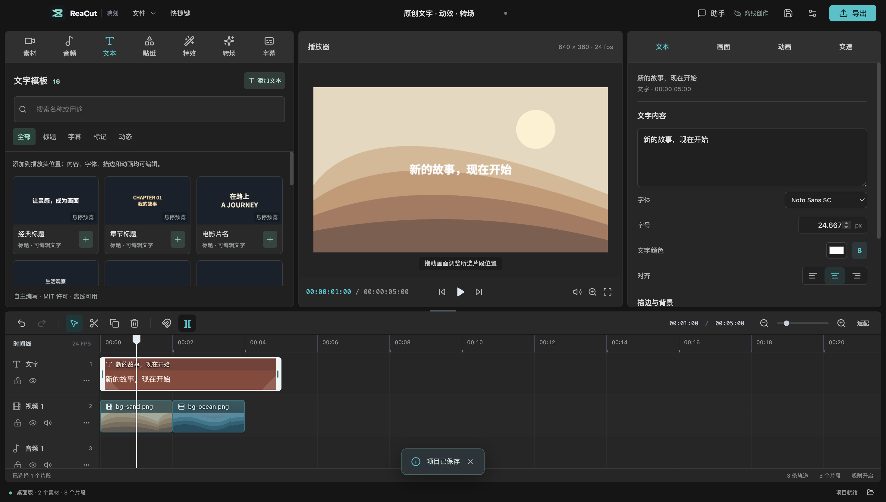
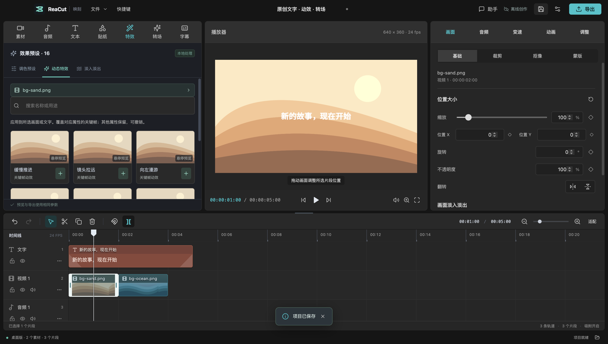
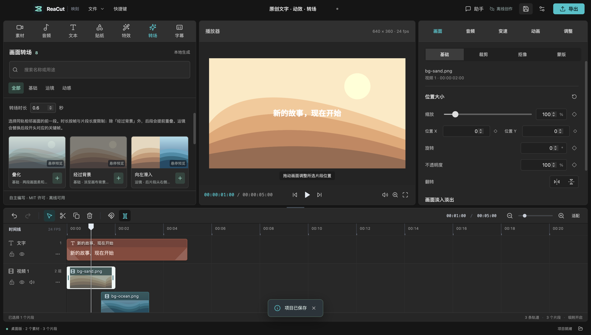

# 文字、特效与转场库

这三类素材是自主编写的参数配方，随源码按 MIT 许可提供，运行不需要下载、登录或调用 AI API。缩略图使用项目生成的沙丘 / 海浪背景和 Noto Sans SC 字体；背景属于原创素材包，字体单独遵循 SIL OFL 1.1。没有复制剪映模板、第三方动画、录音或商标素材。

## 文字模板：16 款

| 分类 | 模板 |
| --- | --- |
| 标题 | 经典标题、章节标题、电影片名、极简刊头 |
| 字幕 | 字幕底条、清晰描边、暖白旁白、访谈引用 |
| 标记 | 薄荷标记、漫画强调、资讯快报、人物姓名牌 |
| 动态 | 轻盈升起、弹跳登场、柔光开场、温柔谢幕 |

在「文本」中搜索或选择分类，点击卡片加号，在播放头位置创建一个 5 秒文字片段。正文、字体、颜色、描边、位置及关键帧继续使用正常属性编辑，不会烧录为图片。字号按画布短边比例调整；标题中的日期、姓名、章节号是可修改的示例文字。

模板添加及新建文字轨道合并为一次撤销。已有文字轨道全部锁定时会新增可编辑轨道。缩略图为了可读性放大了文字，不代表最终字号；播放头位置的实际文字以播放器为准。



## 特效：16 款

- 8 款调色：原色、电影、暖阳、冷蓝、黑白、复古、鲜明、柔焦。
- 8 款动态特效：缓慢推进、镜头拉远、向左漫游、向右漫游、轻盈漂浮、呼吸缩放、轻轻摇摆、节奏震动。

调色作用于图片或视频。动态特效也可作用于文字，生成缩放、位置或旋转关键帧；覆盖同一属性的旧关键帧，保留音量及其他属性。片段边缘淡入淡出仍在独立页签，可分别调整画面和声音。

动效属于片段级变换，没有额外效果轨道；横移、旋转、缩小时可能露出下层画面或画布背景。不是光流、粒子、光效或 AI 人像效果。可继续在右侧修改关键帧，或撤销此次应用。



## 转场：8 款

| 分类 | 转场 | 行为 |
| --- | --- | --- |
| 基础 | 叠化 | 后段提前重叠，以透明度淡入；前段画面保持亮度 |
| 基础 | 经过背景 | 前段淡出至画布背景，后段从背景淡入，不重叠 |
| 运镜 | 向左 / 向右 / 向上 / 向下滑入 | 后段从对应方向进入，前段保持 |
| 动感 | 缩放交接、旋转交接 | 后段缩放 / 旋转并淡入 |

先选择同轨两个相邻画面的前一段，设置时长，再点击卡片加号。时长按项目帧率向下对齐，最大不超过两段各自时长的一半（且不超过 5 秒）。「经过背景」的值分别用于前段淡出与后段淡入；其他预设的值是重叠时长。音频同步设置前段淡出与后段淡入。

应用不裁剪源文件或改变源入点；重叠转场会把后段起点提前，后续片段不自动磁吸移动，因此原本连续的多段时间线可能在后段末尾留下空隙。请在实际播放器检查节奏，需要时再移动后续片段。锁定轨道、片段间有超过一帧的间隙、过大重叠、片段太短，或改变后会与第三段冲突时拒绝应用并提示。

运镜转场替换后段开头对应属性的关键帧，在转场末尾连接原动画的该时刻取值，保留其后的关键帧。叠化 / 经过背景不清除已有运动；如果想从已应用的运镜改回纯叠化，请先撤销运镜。一次撤销恢复两个片段的起点、淡化与关键帧。当前没有独立转场对象、转场轨或拖放到接缝的操作。



## 来源和验证

配方在 `src/core/creativePresets.ts`，调色在 `src/components/EffectsPanel.tsx`；预览使用相同的关键帧插值与透明度包络，最终导出使用现有 FFmpeg 图层合成。所有预设保存为普通 `.reacut` 字段，保存、重新打开、裁剪与导出无需额外模板文件。

素材“公开可访问”不等于可再分发，也不等于公有领域。本库使用明确的 MIT 许可；源码或配方再分发时保留版权与许可文本。详细验证见 [VALIDATION.md](VALIDATION.md)。

```sh
npm run test:creative
npx vitest run tests/creativePresets.test.ts tests/creativeExport.test.ts
```
