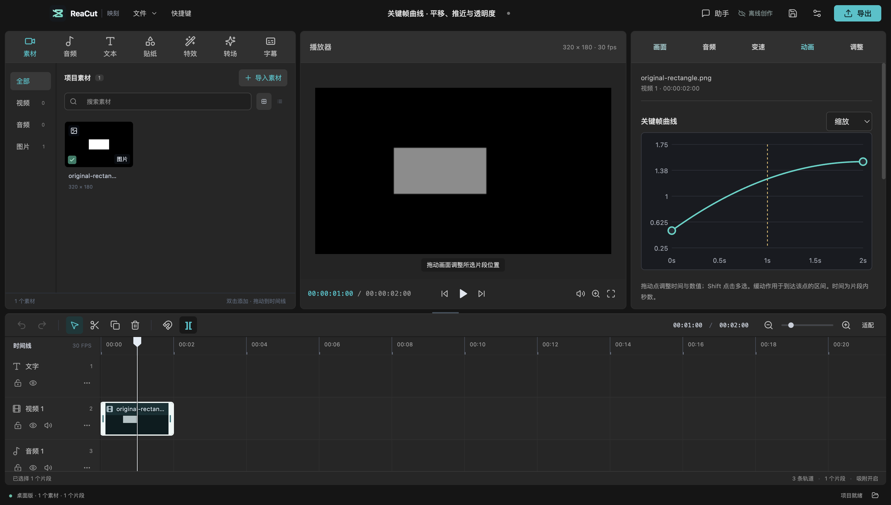

# 关键帧曲线编辑

2026-10-22 新增于源码，尚未包含在已发布的 v0.6.0 预览安装包。使用最新源码构建运行；本次未替换已安装应用、插件或 Release 附件。

## 制作动画

1. 选中时间线片段，在右侧选择 **动画 → 关键帧曲线**。
2. 选择位置 X / Y、缩放、旋转、透明度或音量。纯音频片段只显示音量。
3. 把播放头移到起点，点击 **添加当前帧**，输入初始数值；移动播放头后再次添加，设置终点数值。
4. 选择终点，设置 **进入该点的缓动**。播放或拖动播放头，画面和声音使用同一组关键帧。

时间显示为片段内的秒数，编辑时对齐项目帧率；位置以项目像素为单位，旋转为度，缩放 1 表示原比例，透明度 0–1，音量 0–4。右端点允许位于片段结束时间，用来定义最后一个插值区间；该端点本身不增加成片帧数。

| 缓动 | 完整区间内的进度函数 | 用途 |
| --- | --- | --- |
| 线性 | `t` | 匀速移动或音量变化 |
| 缓入 | `t²` | 从慢到快 |
| 缓出 | `2t−t²` | 从快到慢 |
| 缓入缓出 | `3t²−2t³` | 两端减速、平滑衔接 |

缓动属于**到达所选关键帧的区间**。只有一个关键帧时，其数值保持不变。

## 编辑与复用

- 拖动曲线点同时改变时间和数值，一次拖动对应一次撤销。也可输入精确时间/数值，以 Enter 或离开输入框提交。
- Shift 点击多选，或点击 **选择此曲线全部**。删除只作用于选中关键帧，不删除时间线片段。
- **复制关键帧 → 粘贴到播放头**保留相对时间、数值和缓动，可切换到其他片段后粘贴。以最早选中点作为相对零点；粘贴创建新 ID，同属性同时间点被替换。
- 粘贴超出片段、低目标帧率导致两个点重叠、向纯音频粘贴画面属性时，整次操作拒绝，不留下部分结果。每个片段仍最多 400 个关键帧。
- 曲线获得焦点时支持 Cmd/Ctrl+A/C/V、Delete/Backspace；点获得焦点时 Enter/空格选择，左右方向键逐帧移动，上下方向键调整数值。输入框内保留原生文本编辑行为。
- 锁定轨道禁止修改。保存、重开、撤销和重做使用工程中的同一组关键帧，内部剪贴板不读取系统剪贴板，退出应用后不保留。

裁剪、分割以及转场覆盖前段曲线时，保留剩余缓动的原始区间，避免曲线重新从零开始。手动切换该点的缓动会重置截取窗口。当前提供四种插值，未提供任意贝塞尔手柄或变速曲线；关键帧曲线改变属性，不改变源视频时间映射。

## 验证与演示

- `npm run test:curves`：生成原创透明矩形素材，通过真实 Electron 界面建立平移、推近、透明度三条曲线；拖动/精确输入/删除/复制粘贴/锁轨/撤销/重做、保存与实际进程重启均验收。
- 同一工程的 **60 个预览帧与 60 个导出帧**逐帧比对位置、宽度、矩形内部亮度。位置误差小于 2 项目像素，预览宽度误差小于 3 像素、导出小于 4；内部亮度误差分别小于 3 / 7 个 8-bit 级别。透明边缘缩放的重采样和 H.264 压缩不等于逐像素无损一致。
- `tests/keyframe-curves.test.ts`：四种插值的反复分割/裁剪、极窄曲线窗口、时间冲突、跨片段复制、锁轨、数值范围、400 点上限、撤销及结构验证。
- `tests/keyframe-export.test.ts`：真实视频与音频验证缓入/缓出的裁剪后相位；实际渲染同时缩放和透明度动画，含裁剪路径。导出先在固定源尺寸处理透明度，再动态缩放，避免 FFmpeg 在尺寸变化时滤镜失败。
- 转场回归额外覆盖缓入、缓出、缓入缓出在转场之后的曲线保持。

[机器可读验收记录](validation/keyframe-curves-2026-10-22.json)。本机工程和真实视频位于 `.test-output/keyframe-curves-electron/curves.reacut`、`curves.mp4`，可通过测试重新生成，未引用私人媒体。

本次验收为 macOS Apple Silicon 源码构建。插件协议回归另行记录；不代表新曲线已通过 Codex 宿主侧栏、Windows/Linux 实机或 DMG 验收。使用缓入/缓出的工程需要本次更新后的应用，旧版本不认识新增枚举值并会拒绝打开；旧工程可正常加载。
