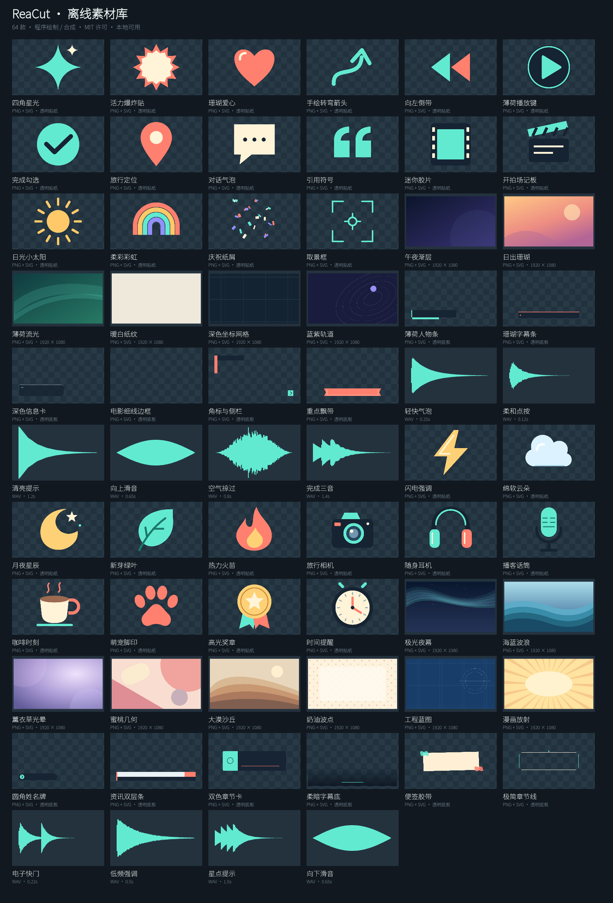
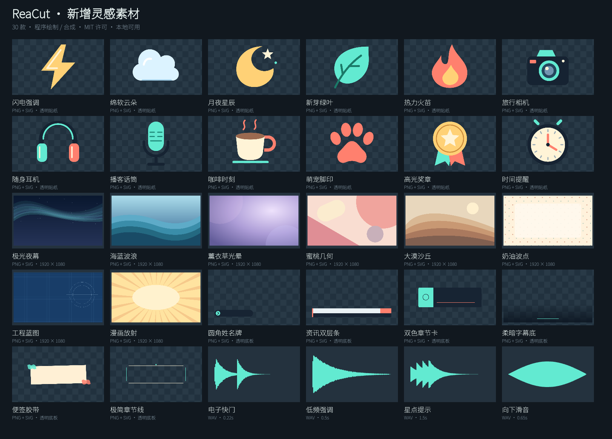

# 原创离线素材

文字、调色 / 动效和转场的参数模板另见 [创意素材库](CREATIVE_LIBRARY.md)，不计入下列 64 个图像 / 音频文件。

本地素材库包含 64 款由本项目自行绘制或合成的资源，不需要下载或登录：

| 分类 | 数量 | 格式与用途 |
| --- | ---: | --- |
| 贴纸 | 28 | 512 × 512 透明 PNG；星光、箭头、爱心、气泡、电影等图形 |
| 背景 | 14 | 1920 × 1080 不透明 PNG；渐层、网格、抽象图案 |
| 标题底板 | 12 | 1920 × 1080 透明 PNG；下三分之一、边框、角标，另外添加可编辑文字 |
| 短音效 | 10 | 48 kHz / 16-bit 单声道 PCM WAV；点击、滑音、提示、空气声 |



这些素材从 SVG 几何图形和确定性音频合成生成，未取用第三方视频、照片、录音或其他应用素材。图形的 SVG 源文件与 PNG 一同存放于 `public/builtin-assets/`；应用使用 PNG，避免不同媒体引擎的 SVG 支持差异。透明贴纸和标题底板保存真实 alpha 通道，棋盘格仅是预览界面。

素材沿用项目 MIT 许可，包含完整许可文本，可用于个人与商业视频。`manifest.json` 记录每个文件的尺寸、用途、来源和 SHA-256；生成方法属于 `original-programmatic`，不冒称人工摄影或 AI 图片。声音是合成的短音效，不是音乐曲库。

这些素材不是“无版权”或公有领域（CC0）素材。MIT 是一份使用许可，分发素材文件、SVG 源或素材包时应保留版权及许可声明；完整条款见 `public/builtin-assets/LICENSE.txt`。用户导入的视频、照片、录音，以及演示中使用的第三方视频不属于本素材包，也不随之获得 MIT 许可。Noto Sans SC 字体另按 SIL OFL 1.1 授权。

## v0.4.1 新增 30 款

- 12 个贴纸：闪电、云朵、月夜、绿叶、火苗、相机、耳机、话筒、咖啡、宠物脚印、奖章、时钟。
- 8 张背景：极光、海浪、薰衣草光晕、蜜桃几何、沙丘、波点、蓝图、漫画放射。
- 6 个标题底板：圆角姓名牌、资讯双层条、双色章节卡、柔暗字幕底、便签胶带、极简章节线。
- 4 个短音效：电子快门、低频强调、星点提示、向下滑音。



旧素材 ID、文件名与生成规则保持稳定，已有项目继续引用原素材。新素材同样保留 SVG 源或音频生成公式，以及清单指纹。

重建素材：

```sh
npx tsx scripts/generate-assets.ts
npx vitest run tests/builtinAssets.test.ts
```

图标按用户指定的剪映左右镜像方向重新绘制矢量几何：交叉带端点朝左，薄荷青渐变配石墨黑圆角底，折角采用短曲线过渡。源文件为 `public/icons/reacut.svg`，由自主坐标路径生成，不嵌入第三方图标位图；视觉方向参考不构成品牌权利或法律审查结论。重建图标使用 `npm run icons`，生成 macOS ICNS、Windows ICO、Linux PNG 和界面图标 `public/icons/reacut.png`。

素材资源随 Vite 公共文件复制进入构建。桌面添加只允许固定清单内的 ID，由主进程解析本地安装资源后进入普通媒体素材流程；项目保存和导出仍使用正常的授权本地素材路径。
