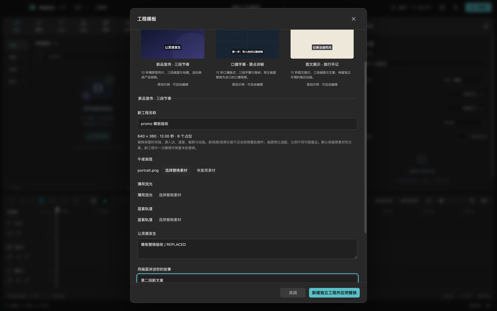
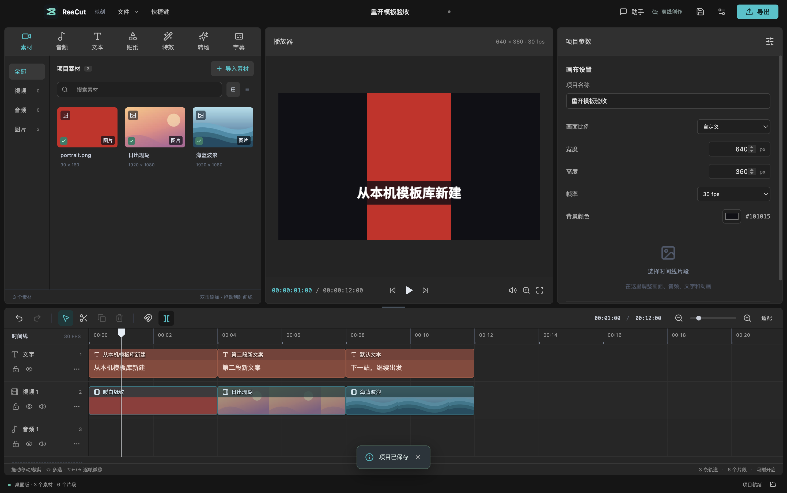

# 可复用工程模板

2026-10-25 源码新增。入口为「文件 → 工程模板…」。尚未更新已发布 v0.6.0 DMG 或已安装插件；需运行当前源码构建。

## 保存自己的模板

打开工程，将播放头放到适合作封面的画面，进入「工程模板 → 保存当前工程为模板」。填写模板名称，勾选允许替换的素材或文案，编辑占位名称，然后「保存模板及媒体副本」。

- 封面取打开面板时播放器的实际画面，保存为 480×270 PNG。工程比例不同时封面等比适配。
- 只收集时间线实际使用的媒体，共用文件去重复制；未使用的素材库文件不进入模板。字体文件和预览缓存不打包。
- 一个媒体占位对应一项素材及其所有引用片段；一个文字占位对应一条文字片段。未勾选的内容仍保留为固定设计。
- 每份模板最多 200 个占位；更大的工程默认仅列出前 200 项，其他内容固定保留。保存总是新建模板副本，不覆盖已有模板。
- 原工程及原媒体保持不变。模板是独立快照，后续编辑工程不会自动更新已保存模板。

## 从模板创作

在模板库选择一份模板，填写新工程名称。可逐个选择媒体，一次修改多段文案，再点击「新建独立工程并应用替换」。未替换的占位保留原内容。关闭有未保存修改的当前工程前，仍会出现原有确认提示。

新工程具有独立的工程、轨道、片段、素材和关键帧 ID，不带模板保存路径。首次保存需另选 `.reacut` 文件。批量替换在新工程中是一步历史记录，撤销恢复模板原有内容，重做恢复整批替换；新建工程本身不会作为旧工程的撤销历史。

替换规则：

| 情况 | 行为 |
| --- | --- |
| 同一素材被多次引用 | 所有引用一起换源，保留原起点、时长、源入点、速度、音量、变换、裁剪、效果与关键帧 |
| 视频轨中的图片/视频 | 可互换；按现有播放器的等比适配规则显示，长宽比变化可能留边，原裁剪与缩放仍生效 |
| 图片轨或音频轨 | 保持原媒体类型；不自动修改轨道类型 |
| 新视频/音频太短 | 按每次引用的 `源入点 + 时间线时长 × 速度` 检查，显示所需秒数并拒绝整个批次；不暗中缩短、循环、冻结或变速 |
| 锁定轨道 | 拒绝该批替换，需先在模板原工程解锁后另存模板 |
| 分离后关联的画声 | 替换后必须继续引用同一源文件，否则拒绝；也可在原工程先解除关联 |
| 文案更长 | 保持字号、布局、时间和动画，继续使用已有文本排版；不自动延长时间线 |

媒体默认引用本机模板库中的副本，新工程编辑不会写回模板。请勿手动删除这些媒体；需搬移新工程时，使用已有「收集项目素材」。本版没有模板删除/覆盖管理入口，避免自动清理破坏工程引用。

## 三套原创示例

三套均为 640×360、30 fps、12 秒，可直接新建和导出，也可先替换再保存为自己的模板：

| 示例 | 可编辑结构 |
| --- | --- |
| 新品宣传 · 三段节奏 | 三段画面、三段标题，文字上滑入场与淡出；视觉占位可换产品视频 |
| 口播字幕 · 要点讲解 | 一段 12 秒主画面、三段字幕与栏目角标；主画面默认使用原创背景，需自行替换口播视频，不包含真人录音或自动识别结果 |
| 图文展示 · 旅行手记 | 三段画面与三段文案，每段保留可调的推近关键帧 |

配方在 `src/core/templateExamples.ts`；使用已有原创图形作为默认媒体，而非新增 64 款素材或第三方模板。封面由实际导出引擎渲染，位于 `public/template-previews/`，可通过 `npm run templates:previews` 重建。配方和原创图形遵循项目 MIT 许可，字体另按其许可；详见 [素材来源](ORIGINAL_ASSETS.md)。用户替换媒体的权利不由此自动取得。

## 导入与导出模板包

选择本机模板后点击「导出原模板包…」，选定父文件夹，生成一个包含媒体的新目录。当前替换表单不会修改或导出原模板的变体；要导出变体，先新建工程再保存成模板。

移动整个目录，在另一处通过「导入模板包…」选择其中的 `模板.reacut-template`。导入验证后复制到本机库，之后不再依赖外部模板包的位置。目录包含：

- `模板.reacut-template`：版本化模板定义、封面、占位和相对媒体引用。
- `项目.reacut`：可以普通项目方式打开的便携快照；对它的编辑不会自动改写模板定义。
- `media/`：去重后的媒体副本；`manifest.json` 是收集时的文件校验清单。
- 使用说明及 ReaCut 原创资源许可；许可说明不覆盖用户自带媒体。

存储复用已有素材包收集器；复制有进度与取消，失败清理本次输出。输入限制为 30 MiB 模板定义、受限 PNG 封面及包内相对媒体路径，拒绝包外符号链接和路径穿越。模板库位于应用用户数据的 `project-templates/`，最多枚举 500 个目录，损坏或媒体缺失的条目不会展示；可从完整包重新导入。桌面与插件各自使用原有独立用户目录，库不会自动跨实例同步。

## 实际验收

在 macOS Apple Silicon 源码构建上验证：

- 类型检查、36 个测试文件 / **411 项测试**和生产构建通过。新增 17 项模板语义/文件测试与三套示例的真实 FFmpeg 导出测试。
- 新 Electron 六组流程通过：新建与批量替换、一次撤销重做、短素材拒绝、名称/封面/占位保存、取消、导出搬移和导入、媒体授权拒绝、实际进程重启；原模板校验值不变。
- 三套示例分别从界面导出 12 秒 / 360 帧的 640×360 视频。采样核对竖图适配留边、替换后画面与预览一致，口播示例的合成替代音可听；没有使用私人视频。测试中的纯色媒体用于验证，不冒充真实口播。
- 原有素材包/区间 6 组、存储恢复 7 组、基础编辑 14 组桌面回归通过。

[机器可读证据](validation/project-templates-2026-10-25.json)。执行 `npm run test:templates` 可复现，视频和工程位于本机 `.test-output/templates-electron/`，成片为 `promo.mp4`、`talk.mp4`、`gallery.mp4`。这些证据不代表 Windows/Linux 实机、最终 DMG 或 Codex 宿主内交互已验证。
