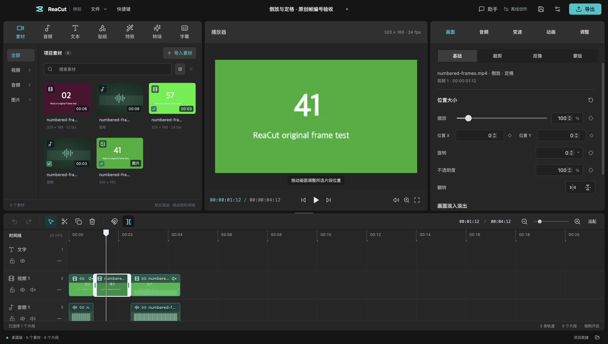
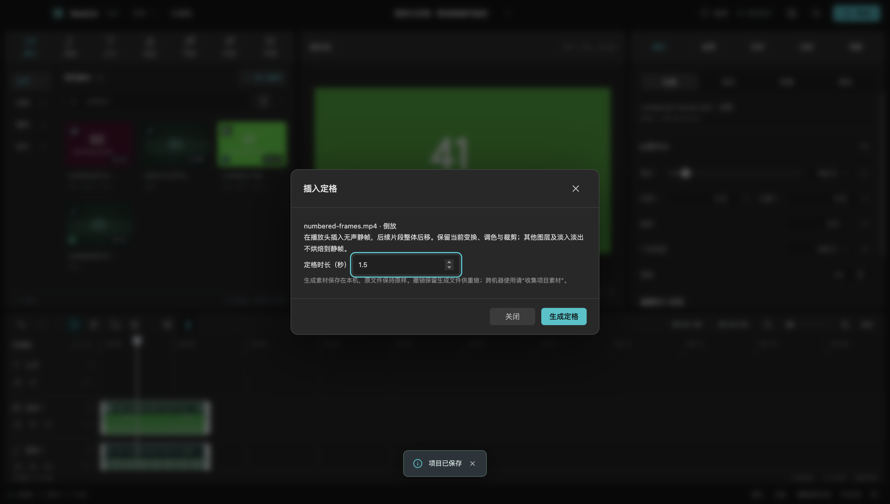

# 本地倒放与定格

这两项能力已包含在 v0.6.0 预览安装包，发布范围见 [安装包验收](RELEASE_0.6.0.md)。操作完全在本地完成。

## 视频倒放

1. 在时间线上选中一个视频片段，点击底部状态栏的 **倒放**。
2. 选择 **原声一起倒放** 或 **移除原声**，点击 **生成倒放**。
3. 等待进度完成。原片段位置和时长保持不变，使用生成的视频替换其素材引用。可一次撤销或重做。

只处理该片段实际使用的源入出点，当前速度烘焙进新素材，新片段速度为 1；之后仍可继续变速、裁剪、分割和添加效果。关键帧、调色、裁剪及淡化继续按原时间线方向执行，并不把这些效果倒序。

分离后关联的画声会一起替换，并保留原来的静音状态。关联成员必须使用同一源文件、起点、时长、源入点及速度，否则提示先解除关联。任一成员锁轨都会阻止操作。没有关联的其他片段不受影响；移除原声会生成不含音轨的文件。

## 插入定格

1. 选中视频，将播放头移到片段内（不含右端点），点击底部 **定格**。
2. 设置时长，点击 **生成定格**。
3. 在播放头插入无声图片片段，原视频在此切开，后续所有轨道整体后移。

静帧取自所选视频当前源位置，保留当前关键帧求值后的变换，以及调色、裁剪、抠像和蒙版参数。不会把其他轨道、文字或淡入淡出烘焙到静帧。新片段不含动画关键帧，因此画面保持静止；仍可在属性面板修改时长或拖动边缘。锁定轨道若会被后移，操作在生成前就被拒绝。

## 生成文件与项目管理

- 原文件不被覆盖。生成的视频/PNG 位于应用用户目录的 `derived-media/`，使用普通项目素材引用，预览和导出读取同一个文件。
- 相同来源路径、文件大小、修改时间和处理参数会复用已完成结果。中间编码分段在完成、失败或取消时清理；生成后的完整文件不会随撤销删除，以支持重做和已保存项目。
- 当前不自动清理完整衍生素材。删除应用数据可能使已保存项目缺素材；跨机器迁移或归档，请使用 **文件 → 收集项目素材**，它会包含实际生成的文件。
- 处理过程中可取消。若项目在处理期间被其他入口修改，完成结果不会覆盖新的编辑，需要重新选择片段操作。
- 每次只运行一个衍生任务。倒放最长 60 分钟，定格时长一帧至 60 分钟；输入最大像素量为 4096×2160，单边不超过 8192。倒放时长需对齐项目帧率。
- 倒放采用 H.264/AAC（移除原声则无 AAC）重新编码，不是无损视频转换。速度/帧率先规范化，随后按内存预算分段倒放；中间文件占用磁盘空间，完成后清理。当前为 SDR 8-bit 输出，不保留 HDR 元数据。

## 验证与演示

- `tests/derivative-edits.test.ts`：画声关联、锁轨、静帧变换、整体插入、撤销/重做与 JSON 保存模型。
- `tests/derivatives.integration.test.ts`：真实 FFmpeg 逐帧身份及时间戳、源入点与变速、VFR 间隔、声音倒序、静音、缓存复用、取消清理、素材包包含生成文件。
- `tests/derivatives-electron.ts`：界面取消、关联倒放、定格插入、一次撤销/重做、实际进程重启、预览、108 帧成片逐帧核对、定格区间静音及原文件 SHA-256 不变。

运行 `npm run test:derivatives` 可重新生成原创帧编号素材与桌面验收结果。本地产物位于 `.test-output/derivatives-electron/`，其中 `reverse-freeze.mp4` 是真实导出视频，`reverse-freeze.reacut` 是可重开的工程。

机器可读结果见 [10 月 21 日验收记录](validation/reverse-freeze-2026-10-21.json)。本轮使用 macOS 源码构建，不代表 Windows/Linux、最终 DMG 或 Codex 宿主面板已验收。
