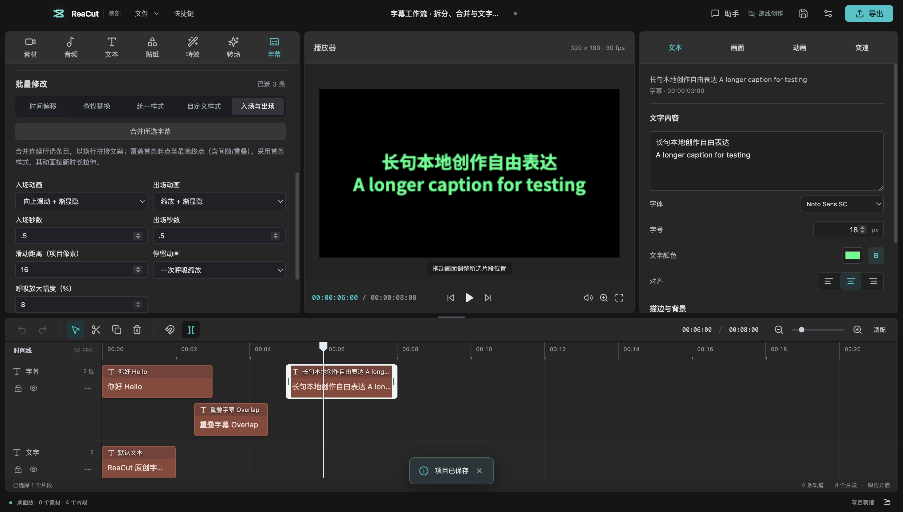

# 字幕修整、批量样式与文字动画

2026-10-23 源码新增。需从当前源码构建；这些操作尚未进入已发布的 v0.6.0 DMG 或已安装插件。使用新缓入/缓出关键帧的工程不能由旧版应用打开。



## 导入与拆分

1. 在左侧「字幕」导入 SRT / 基础 WebVTT，选定字幕轨道。
2. 选中一条字幕，先保存文本或时间修改。
3. 将播放头定位到时间分界，再在字幕编辑文本框中将光标放到文案分界，点击「在播放头与文本光标拆分」。

时间分界对齐项目帧率，两侧至少一帧。文本按光标分开，不自动猜测语义或平均分词，不切开组合字符或表情，两侧均需含非空白文本。原有曲线和淡化沿分界保留各自相位。一次撤销恢复整条字幕；关联片段需先解除关联。

## 合并与批量样式

勾选同轨连续的至少两条字幕，点击「合并所选字幕」，检查结果后应用。不能跨过未选择的条目，即使搜索暂时隐藏了它。文案以换行拼接，时间从首条开始到最晚结束，因此原间隙会被填满、重叠内容会合到同一片段。采用首条字体、样式和变换，将其动画及淡化时长按新总时长等比例拉伸，其他条目的独立样式与动画不保留。合并可一次撤销。

「自定义样式」支持直接设置字号、文字色、背景色、描边色/宽度、粗体与对齐，检查修改后一次应用到勾选字幕。保留每条文案、字体族、时间、画面变换和动画；需要复制完整字体样式时使用已有「统一样式」参考条目功能。锁轨或检查后工程发生变化时拒绝提交，重新检查后才能应用。

## 入场、停留与出场

在「入场与出场」分别设置：

- 入场/出场：无、渐显隐、向上滑动加渐显隐、缩放加渐显隐。可调时长；滑动距离以项目像素计。
- 停留：静止或一次呼吸缩放，呼吸放大幅度为 0–50%。停留中点放大后回到原比例，并非持续循环动画。
- 停留时长由每条字幕总时长减去入场和出场得到；动画时长对齐帧率。静止至少保留一帧，呼吸至少两帧；启用的入场/出场至少一帧。任何所选字幕过短都拒绝整个批次，不会只改一部分。

应用会替换所选片段的 Y、缩放、透明度关键帧及画面淡化，保留 X、旋转、音量关键帧、文本和基础变换。选择「无 / 静止 / 无」可以清除上述动画。每次应用可一次撤销或重做。

动画生成普通关键帧，保存重开后保留，并可继续在右侧「动画」曲线中精调。表单显示下一次应用的参数，不反推已经手动修改过的关键帧配方；重新打开表单不会丢失已有动画。预览和 FFmpeg 导出共用这些关键帧，不需要联网或额外模型。

## 保存与导出

保存 `.reacut` 保留文字、样式、时间与动画。导出视频将文字及动画渲染到成片中；导出 SRT 只保留文本和时间（含重叠），不携带字体、颜色或动画。基础 WebVTT 导入也不保证保留其定位及富文本属性。

## 验证和复现

本次在 macOS Apple Silicon 源码构建验收，未替换已安装应用或 Release，也未宣称 Windows/Linux、最终 DMG 或 Codex 宿主内交互已验收。

```sh
npm run check
npm run test:subtitle-workflow
```

- 类型检查、34 个文件 / 391 项测试和生产构建通过。新增 23 项字幕语义测试涵盖中英/表情边界、重叠/间隙、锁轨、过时计划、原子历史、SRT/WebVTT 与保存结构。
- 8 个真实 FFmpeg 用例覆盖四种入出场模式 × 两种停留模式，每例解码 60 帧，对照模型核对位置、尺寸、透明度。
- Electron 四组流程使用自造中英文、长句与重叠字幕，实际执行导入、文本光标拆分、合并、样式、动画、撤销重做、SRT 导出、保存与进程重启，以及 UI 发起的视频导出。
- 成片 8 秒 / 240 帧；其中动画字幕的 12 个采样点与真实播放器截图对照：纵向中心误差小于 3 项目像素，宽度差小于 6 像素。用字形整体亮度并校正缩放面积估计透明度，两种渲染各自相对模型误差小于 0.06；字体边缘采样和视频压缩可能略有差异，不宣称像素完全相同。
- 原有字幕桌面 8 组、大字幕项目 3 组、基础编辑 14 组回归通过；无 renderer errors。

[机器可读证据](validation/subtitle-workflow-2026-10-23.json)。复现生成的工程、字幕、截图和成片位于本机 `.test-output/subtitle-workflow-electron/`，视频为 `captions.mp4`。测试素材完全由脚本生成，不含私人视频或第三方模板。
