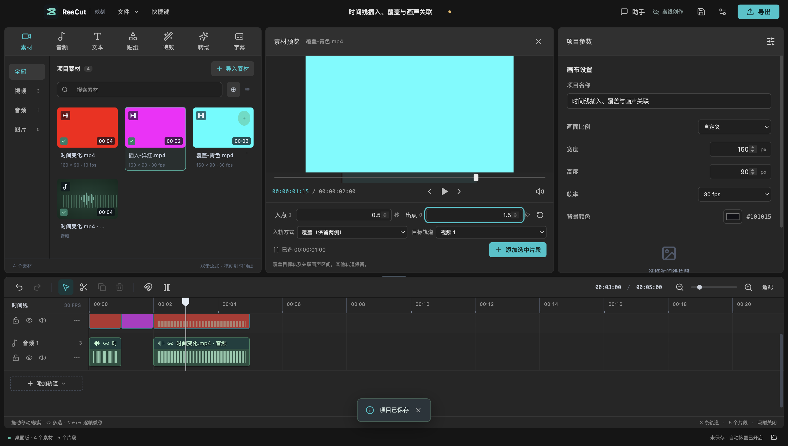
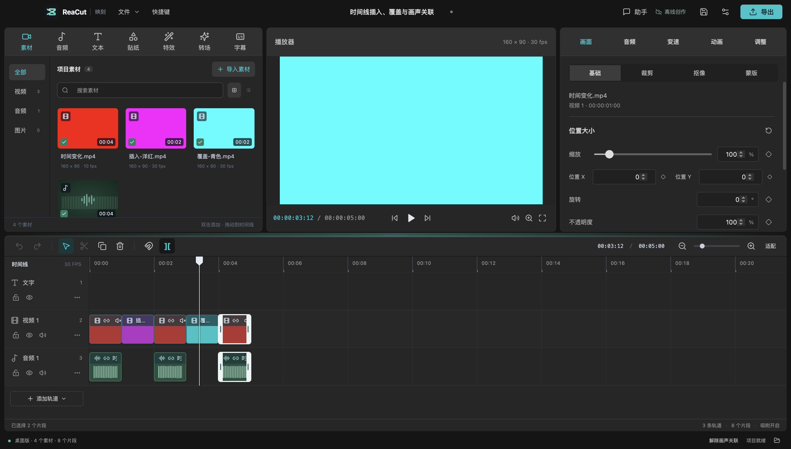

# 插入、覆盖与画声关联

2026-10-20 的源码新增功能。当前已发布的 v0.5.0 安装包不包含本页功能；可从最新源码 `npm ci && npm run dev` 运行。本周结束统一验收安装包候选。

## 在源预览中选择入轨方式

1. 把时间线播放头放在要剪入的位置，再单击素材卡片。
2. 使用 I/O 或数字输入框设置源素材入点和出点。
3. 选择“入轨方式”和“目标轨道”，点击“添加选中片段”。图片使用其默认时长。

| 方式 | 既有片段如何处理 |
| --- | --- |
| 插入（默认） | 整条序列的所有轨道一起让位：跨越播放头的片段切为两段，后半段和后续片段后移选段时长。空隙也保留。 |
| 覆盖 | 仅裁掉目标轨与对应关联画声中被覆盖的时间区间，保留左右剩余部分及原来的源范围。其他独立轨道不变。 |
| 叠加 | 不切开或移动既有片段，允许重叠，沿用原有同轨合成方式。 |

显式指定的目标轨道必须兼容且未锁定。“自动选择 / 新建”寻找可编辑的兼容轨道，没有时创建。插入如果影响任一锁轨上的片段，或覆盖需要裁剪锁定的关联伙伴，整次操作拒绝，源预览与原项目保留。

位置对齐项目帧率；选段尾部不足一帧的部分向下取整，避免读到出点之外。裁切后不足一帧的残片不保留。每次入轨操作，包括切片、移动及必要的新建轨道，都只有一次撤销。



双击素材、卡片加号和素材拖放仍沿用原来的完整素材添加行为；插入 / 覆盖模式通过源预览显式选择。

## 画声保持同步

选中带声音的视频，点击底部“分离音频”：原视频静音，生成独立音频片段，二者以链条图标显示关联。

- 单击任一片段会选中整组；右侧属性显示本次点击的片段，因此仍可分别调整音量或画面。
- 拖动、键盘微移、裁剪和分割作用于关联组。裁剪共同受最短可用源范围限制；分割后左右形成独立的两组。
- 属性中的开始时间、源入点和速度调整也同步关联伙伴。叠化等转场会移动对应音频并设置声音淡化。
- 任一关联成员所在轨道锁定时，移动、裁剪、分割和解除关联均不执行。
- 点击底部“解除画声关联”后可以分别移动；撤销能恢复关联。关联信息随 `.reacut` 保存，重新打开继续有效。
- 复制/粘贴和复制片段为新副本创建新的关联，不与原片段绑定。
- 普通删除会删除整组。磁性删除沿用同轨区间压缩；如果会使后续关联画声错位，明确提示并拒绝整次删除。关闭磁性删除或解除关联后可继续。

当前没有“把任意已有片段重新关联”的入口；关联从“分离音频”建立。自由拖动仍允许同轨重叠，插入/覆盖的替换规则不会被隐式套用到拖动。



## 验证与复现

```sh
npm run check
npm run test:editing
```

`tests/timeline-edits.test.ts` 覆盖区间替换、源范围、锁轨、关联移动/裁剪/分割、关键帧和淡化相位、撤销、重开数据、复制、转场与助手编辑。

桌面测试使用三个自行生成的视频：四段变色/变音调视频、洋红色 660 Hz 视频、青色 330 Hz 视频。实际执行鼠标移动、键盘裁剪、解除关联、I/O 插入、覆盖、保存及进程重启；随后通过界面导出五秒成片。解码后的画面依次为红、洋红、绿、青、黄；音调依次为 440、660、880、330、220 Hz，各区间单声道 RMS 约 0.088，无旧声音重复混合。没有使用私人媒体。

本机证据位于 `.test-output/timeline-edits-electron/`：`evidence.json`、`rough-cut.reacut`、`rough-cut.mp4` 及两张界面截图。证据文件不是预置结果，运行测试会重新生成。

本轮是 macOS 源码桌面验证。既有助手 / 插件的移动、裁剪、分割、删除和变速提案复用关联逻辑；新增入轨方式暂通过完整编辑器界面操作，尚未新增专用 MCP 操作 schema 或验证 Codex 宿主中的本轮交互。Windows / Linux 未进行实机验证。
