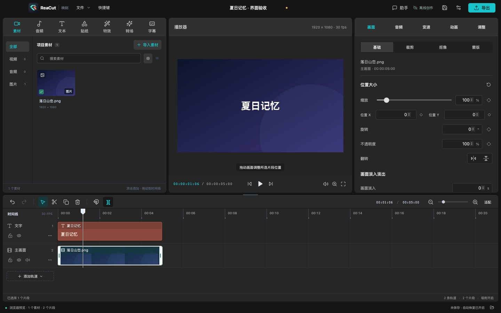

# 桌面编辑界面一致性

日期：2026-10-13，Asia/Shanghai。目标是让熟悉剪映桌面版的用户沿用主要区域与操作分类，不宣称逐像素复刻或完整功能对等。ReaCut 保留原创图标、品牌和素材，界面由本项目自主实现。

## 参考与差异分析

参考为已有授权观察中的空编辑器与自造媒体变换截图：本机剪映 `11.0.12922` / 构建 `11.1.0-beta3`。私有证据路径为 `.research/evidence/rea-native-ui-editor.png`、`.research/round2/variation/transform-final.png`；没有为本轮界面修改读取私人草稿、访问账号或再次操作第三方应用。

截图直接可见：素材分类居左、播放器居中、属性居右，时间线横跨底部；项目名称在标题栏居中，导出在右侧；表面以中性深灰分层，青色用于当前类别与操作；资源图标带文字；画面属性采用主类别和基础/抠像/蒙版等二级分类；缩放为滑块加数字输入，位置以 X/Y 分组；所选时间线片段有浅色边框，文字轨为红棕色。以上是截图观察，不能推出没有观察到的交互行为。

| 差异 | 本轮自主实现 | 仍然不同 |
| --- | --- | --- |
| 原蓝灰面板、薄弱层级 | 中性深灰、统一 52px 面板标题、44px 应用标题栏、青色强调 | 不追求专有主题精确色值与像素坐标 |
| 顶部资源类别顺序 | 素材、音频、文本、贴纸、特效、转场、字幕 | 没有复制云素材、会员入口、智能包装、商业模板 |
| 本地素材类型横排 | 宽素材面板使用左侧类别栏，搜索与媒体卡片在右；窄面板保留横排以保证可用空间 | 类别对应真实本地媒体类型，未伪造未实现的资源服务 |
| 画面工具全部平铺一级、需横向滚动 | 画面/音频/变速/动画/调整主分类；画面下基础/裁剪/抠像/蒙版 | 文字与音频类别按实际支持能力显示；不展示 AI 美颜等空功能 |
| 单列位置与纯数字缩放 | 缩放滑块与数字同步；宽面板 X/Y 并排，窄面板回到单列；关键帧菱形保留 | 当前是等比缩放，没有独立 X/Y 比例或画面圆角 |
| 时间线颜色与选框 | 中性轨道背景、白色选中边框、红棕文字轨、较紧凑工具栏 | 轨道高度与剪辑模型沿用 ReaCut；多时间线标签、封面轨尚未实现 |
| 素材直接添加、没有源选段流程 | 单击源预览，I/O 标记后插入；双击保持整段添加，点击时间线返回项目预览 | 新增行为为自主设计与验收，未宣称原生快捷键完全一致 |
| 三栏固定比例 | 分隔线拖动、键盘微调、跨启动记忆、双击/Home 恢复默认；小窗口保持最低可用宽度 | 默认比例兼顾 ReaCut 工具密度，允许用户按习惯调整 |
| 小窗口助手底部遮挡 | 1024×720 下输入框及发送按钮可见 | 最短窗口的对话区域空间有限，可拖低时间线增加高度 |

## 验证范围

- `npm run typecheck`、`npm run build` 通过。
- 源预览组件在 React StrictMode 中通过 8 组浏览器媒体检查；实际 Electron App 验证 I/O 插入、保存的 sourceIn/duration、单次撤销、1024×720 控件可见，以及一秒蓝色画面和可听音频导出。桌面测试主动降低最小窗口宽度来覆盖 1024px，正常应用最小宽度仍为 1060px。
- 浏览器真实渲染检查：1440×900 与 1024×720，自造图片/文字项目；切换基础、蒙版、变速；编辑缩放与位置值，确认项目状态变化；真实拖动缩放滑块产生多次输入，但仅增加一条撤销记录，撤销恢复原缩放；无 renderer errors。
- 1024×720 主编辑器三列宽度为 280 / 434 / 280px，右边界 1016px，无横向页面溢出。开启助手后播放器 404px，助手右边界仍为 1016px。
- 空项目助手发送按钮底部为 367px，面板底部 374px，按钮位于可见面板内。几何验收与截图保存在 `.test-output/ui-parity/`。
- `tests/visual-ui-electron.ts` 通过：实际桌面裁剪、色度抠像、蒙版、锁轨与三次真实媒体导出；无 renderer errors。
- `tests/app-electron.ts` 通过：真实导入、播放、分割撤销、文本属性、调整、变速、关键帧、字幕导入、保存重开与 5 秒视频导出；无 renderer errors 或媒体失败。

这些检查证明本轮改动下的 ReaCut 界面布局及已有编辑功能可用，不是与剪映的逐像素/行为一致性认证，也不证明 Windows / Linux 已验证。数值属性保留原有 `aria-label` 与自动化定位：显示“变速”仍以“速度”为兼容可访问名称，显示“调整”仍以“调色”为兼容可访问名称。

